# Week 10：RAG 系列（多輪 RAG、VideoRAG、RAG 評估、GraphRAG）

本週包含四個 Quiz，全部在 `main.ipynb` 依步驟分 cell 執行，核心程式放在 `Codes/`。全部使用預訓練模型做推論與檢索，沒有訓練步驟，在單張 RTX 3090（24 GB）上完成。

| Quiz | 任務 | 資料 | 方法 | 主要結果 |
|---|---|---|---|---|
| 1 | 多輪對話 RAG | 繁中維基百科 29 篇（AI / ML 主題），自製 120 題 QA + 38 組多輪題 | bge-m3 檢索 + Qwen2.5-7B，查詢改寫 + 引用 | 最佳設定 chunk 150 / overlap 50 / top-k 8；grounded_strict prompt：judge 4.70、引用率 100%、語料外題拒答 100% |
| 2 | 多輪 VideoRAG | 10 支影片（有聲 5 / 無聲 5）→ 68 個 10 秒 clip | Whisper 逐字稿 + VLM 畫面描述 + bge-m3 ⊕ Chinese-CLIP 融合檢索，Qwen2.5-VL 生成 | 4 輪 demo 全部找到正確影片並附時間戳引用；附 Gradio UI |
| 3 | RAG 評估 | Q1 的 60 題 + 38 組多輪題；影片 40 題（語音 20 / 視覺 20） | RAGAS 四指標（本地 judge 重新實作）+ VideoRAG 延伸評估 | 文字 RAG：hit 1.00、faithfulness 0.86、correctness 0.90；多輪 LLM 改寫 Hit 0.87；影片融合 Near Hit@3 0.90（純文字 0.83、純視覺 0.55） |
| 4 | GraphRAG | *Attention Is All You Need* 論文，25 題 benchmark | LLM 實體/關係抽取 → 圖 → Louvain 社群；naive / local / global / hybrid | hybrid 最佳：judge 4.68、正確率 0.96（24 / 25） |

## 專案結構

```
week10/
├── main.ipynb          # 主要執行流程與每題結果分析（每個結果 cell 後有「📊 結果解讀」）
├── README.md
├── requirements.txt
├── Codes/
│   ├── common.py       # 共用：ChatLLM / VLM / Embedder 封裝、GPU 記憶體管理、LLM-judge、Gradio 相容工具
│   ├── Quiz1.py        # 語料下載、切塊、向量索引、QA 生成與品質過濾、多輪 RAGChat、網格搜尋、prompting 比較、UI
│   ├── Quiz2.py        # 影片切 clip、ASR、VLM 描述、Chinese-CLIP、雙索引、VideoRAGChat、UI
│   ├── Quiz3.py        # RAGAS-style 評估、多輪消融、影片 benchmark 與檢索/生成評估
│   ├── Quiz4.py        # 論文抽字、圖建構、社群偵測與摘要、GraphRAG 四種模式、benchmark
│   └── asr_worker.py   # 在子行程中執行 ASR（自動切換後端），結束後釋放 GPU
├── Data/               # 語料、QA 資料集、影片（Data/q2_videos/voice、no_voice）、快取、論文 PDF、benchmark
└── Outputs/            # 所有圖片（Q{n}_*.png）、索引與圖譜（q{n}_*）、結果表（q{n}_*.csv）
```

## 環境與執行

- Python 3.11；torch 2.15（CUDA 13.2）、transformers 5.23、sentence-transformers、gradio 6.30、faster-whisper、opencc、networkx、pymupdf，完整清單見 `requirements.txt`。
- 使用模型：Qwen2.5-7B-Instruct（文字 LLM，bf16）、Qwen2.5-VL-7B-Instruct（VLM）、BAAI/bge-m3（文字 embedding）、OFA-Sys/chinese-clip-vit-large-patch14（畫面 embedding）、openai/whisper-large-v3-turbo（ASR）。
- ASR：`asr_worker.py` 依序嘗試 faster-whisper（GPU）→ transformers Whisper（GPU）→ faster-whisper（CPU）。本環境的 torch 是 CUDA 13 版，faster-whisper 需要的 `libcublas.so.12` 不存在，所以實際使用 transformers 的 whisper-large-v3-turbo。
- 顯存管理：一次只放一個 7B 模型（文字 LLM 15.2 GB、VLM 16.5 GB、VLM + bge-m3 + CLIP 17.3 GB）。切換時用 `release(globals(), ...)` 關閉 UI 並卸載；`ChatLLM()` / `VLM()` 建構時也會自動卸載前一個模型。
- 依序執行 `main.ipynb`。語料、QA、影片描述、逐字稿、論文抽取結果都會快取在 `Data/`，第二次執行會直接讀取。**修改 `Codes/` 後要重啟 kernel**，否則會繼續使用舊程式。
- 影片放在 `Data/q2_videos/voice/`（有說話）與 `Data/q2_videos/no_voice/`（無說話），**資料夾名稱即有無說話的標籤**。
- 本地 LLM-judge：官方 `ragas` 套件預設呼叫 OpenAI；為了完全本地執行，依 RAGAS 定義用 Qwen2.5-7B 當 judge 重新實作（1–5 分）。
- 圖片內文字一律使用英文；圖片存成 `Q1_*`…`Q4_*`，索引 / 圖譜 / 設定存成 `q1_*`…`q4_*`。

---

## Quiz 1：多輪對話 RAG

**資料**
- 從繁中維基百科下載 AI / ML 條目（`variant=zh-tw` + opencc 轉繁體；每次請求間隔 1 秒，遇到 HTTP 429 會等待重試）。候選 32 篇，**29 篇、136,392 字**（3 篇內文不到 800 字被略過）。
- 預設切塊（300 字、overlap 50，以句子為單位）得到 **562 個 embedding**；最終設定（150 / 50）為 **1,363 個**，都滿足 ≥ 200 的要求。
- **自製 QA 資料集（120 題）**：Qwen2.5-7B 出題，證據必須是原文的逐字片段（才能用字元位置自動判斷檢索是否命中）。264 個候選經過三道過濾：格式 / 證據不符（−53）、規則過濾「第一句」「這個例子」等依賴上下文的問題（−3）、LLM 自我檢查「問題是否獨立、證據是否支持答案」（−29）。
- **多輪資料集（38 組）**：26 組同主題的代名詞追問（「那它的缺點呢？」）+ 12 組換主題（第一輪問文件 A、第二輪改問文件 B），後者用來檢驗對話歷史變成雜訊時的表現。

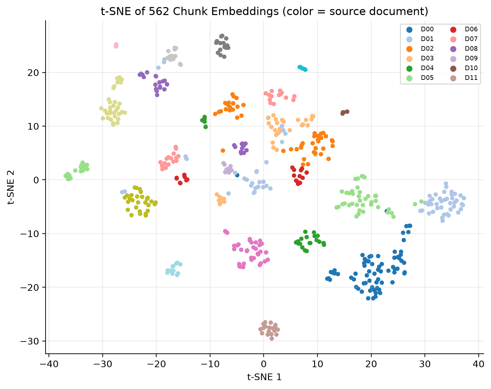

同一篇文件的 chunk 大多聚成一群；深度學習、人工神經網路、CNN 等相近主題彼此相鄰，可能互相誤檢索。

**多輪 Demo**：4 輪對話中，第 2～4 輪都用代名詞追問（「它」、「其中」）。系統先用 LLM 把追問**改寫成獨立查詢**再檢索，回答以 `[編號]` 引用，並列出 References。

```
👤 其中卷積神經網路主要用在什麼任務上？
🔁 standalone query: 卷積神經網路主要用在什麼任務上？
🤖 卷積神經網路主要用於影像和語音辨識 [2]，視訊分析 [3]，以及自然語言處理 [3]。
📎 [2] ✔ cited | D06 卷積神經網路 | score=0.735 | 卷積神經網路（英語：convolutional neural network，縮寫：CNN）是一種前饋神經網路…
```

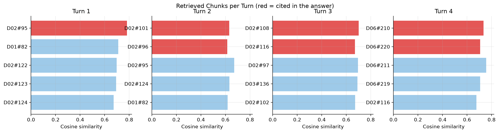

### 進階 ①：最穩定的 Chunk Size / Overlap / Top-K

網格為 chunk {150, 300, 500, 800} × overlap {0, 50, 100, 150} × k {1, 3, 5, 8, 10}，用 120 題 QA 評估檢索。
分數 = 0.5 × macro 命中率 + 0.5 × MRR − 跨文件標準差 − 0.05 ×（context 千字數）：K 大時 Hit@K 會飽和，所以把 MRR（正確 chunk 排得多前面）放進分數，同時懲罰不穩定與過長的 context。分數最高的 3 組再做端到端（60 題）驗證。

| 設定（K = 8） | Hit@1 | MRR | std_doc | context 長度 | score |
|---|---|---|---|---|---|
| **c150 / o0** | 0.642 | 0.750 | 0.048 | **970 字** | **0.771** |
| c150 / o50 | 0.642 | 0.753 | 0.056 | 960 字 | 0.765 |
| c300 / o150 | **0.650** | **0.764** | 0.050 | 2,139 字 | 0.716 |
| c500 / o0 | 0.625 | 0.754 | **0.031** | 3,621 字 | 0.661 |
| c800 / o150 | 0.617 | 0.749 | 0.061 | 5,849 字 | 0.512 |

| 端到端候選 | judge | char F1 | hit |
|---|---|---|---|
| **c150 / o50 / k8** | **4.700** | 0.566 | 0.983 |
| c150 / o0 / k8 | 4.583 | 0.587 | 0.983 |
| c150 / o50 / k10 | 4.533 | 0.569 | 0.983 |

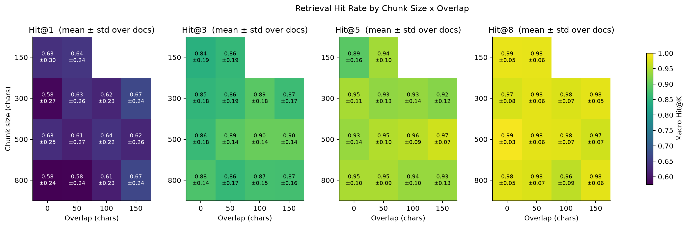

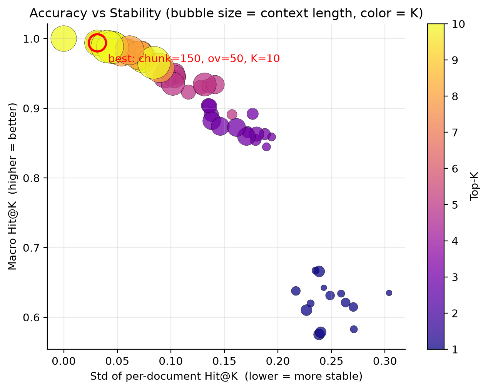

**結論**
- 語料擴大到 29 篇後，Hit@K 的天花板效應消失：Hit@1 只有 0.58–0.67、Hit@3 約 0.85–0.90，K = 8 時仍有 0.96–0.99。
- **各 chunk size 的排序品質很接近**（MRR 0.70–0.77），拉開分數的是 context 長度：K = 8 時 chunk 150 只需約 970 字，chunk 800 要約 5,800 字。因此 chunk 150 綜合最佳。
- K = 1 時跨文件標準差高達 0.22–0.30，只取 1 個 chunk 時命中率很依賴主題；K ≥ 5 才穩定。
- 最終選 **c150 / o50 / k8**（端到端 judge 最高）。三組候選的差距約 0.17 分（n = 60），不顯著。

### 進階 ②：最合適的 Prompting Technique

在 60 題可回答題與 12 題語料外題（用來量測幻覺）上比較 5 種技術：

| 技術 | judge ↑ | char F1 ↑ | 引用率 ↑ | 語料外題拒答率 ↑ | 可回答題誤拒答 ↓ | 平均長度 | 秒 / 題 |
|---|---|---|---|---|---|---|---|
| **grounded_strict** | 4.700 | **0.566** | **1.000** | **1.000** | 0.033 | 70 | **0.67** |
| few_shot | **4.750** | 0.428 | 0.883 | **1.000** | 0.000 | 132 | 0.99 |
| zero_shot | 4.583 | 0.333 | 0.317 | 0.417 | 0.000 | 207 | 1.34 |
| cot | 4.367 | 0.461 | 0.983 | **1.000** | 0.017 | 70 | 1.45 |
| extract_then_answer | 3.933 | 0.515 | 0.983 | **1.000** | 0.000 | 54 | 1.01 |

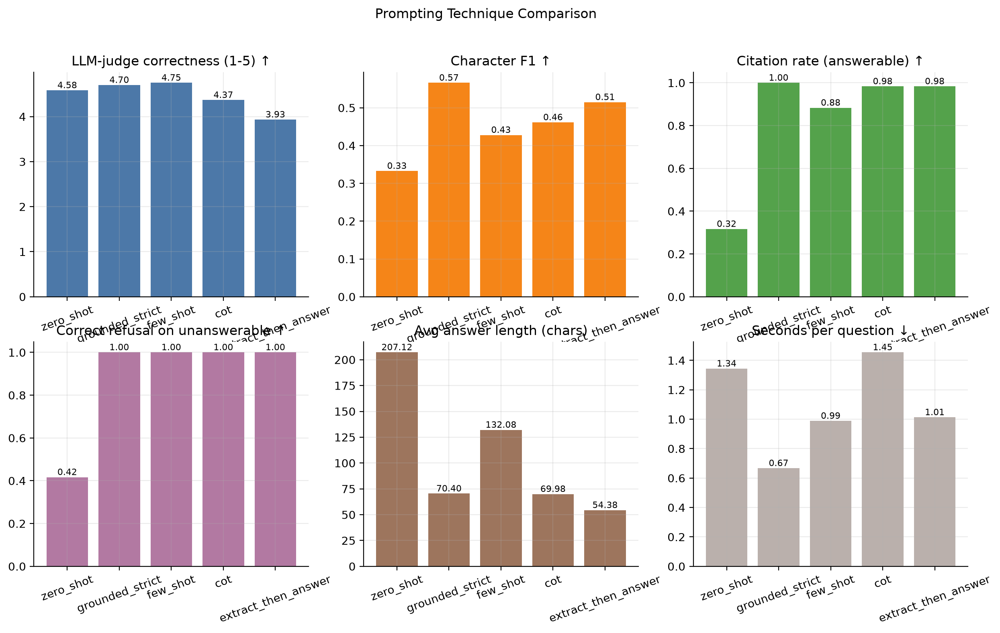

**結論**
- 選擇 **grounded_strict**（嚴格規則：只能用參考資料、每個論點標註 `[編號]`、資料不足時回覆固定句）。它的 judge 只比 few_shot 低 0.05（不顯著），但 char F1 最高、每個答案都有引用、語料外題全部拒答、速度最快、答案長度只有 few_shot 的一半。代價是 60 題中有 2 題誤拒答。
- zero_shot 不適合 RAG：12 題語料外題只拒答 42%（58% 幻覺），而且只有 32% 的答案有引用。
- extract_then_answer 最差：先摘錄再作答容易漏掉細節。

### 進階 ③：User Interface

Gradio 介面：左側是多輪對話；右側可即時調整 Top-K、Prompt 技術、是否改寫，並顯示改寫後的獨立查詢，以及可展開、標示是否被引用的 References。


---

## Quiz 2：多輪 VideoRAG

**資料**：`no_voice` 5 支（Excel 條件格式、Excel 範本、Google Drive 掃描、TeePublic 上傳、Turbo VPN）與 `voice` 5 支（Excel AVERAGE、Excel MAX、RAG 講解、iPhone 螢幕錄影、OneNote 錄音），長度 20～128 秒，切成 **68 個 10 秒 clip**，每個 clip 取 4 張畫面。

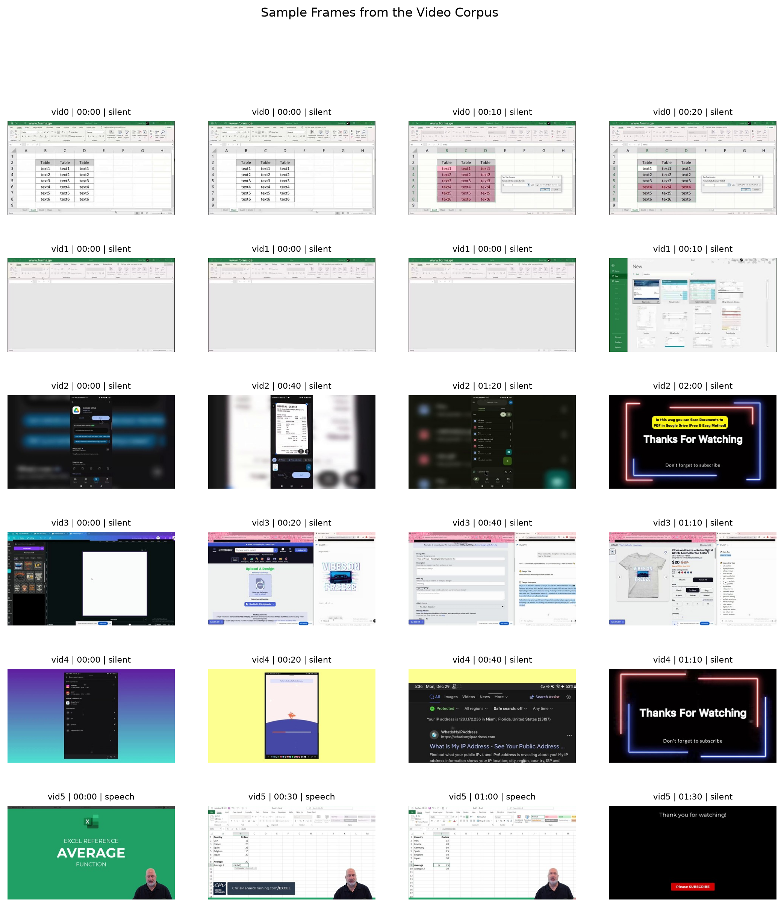

**方法**（參考 VideoRAG, Jeong et al. 2025 並改編）

| | 原 VideoRAG | 本作業的改編 |
|---|---|---|
| 檢索單位 | 整支影片 | **10 秒 clip**（可回報時間戳） |
| 有聲影片 | ASR 字幕 | Whisper 逐字稿（word-level 時間戳重組成 ≤ 8 秒的句子，對應到 clip） |
| 無聲影片 | 以 VLM 產生輔助文字 | Qwen2.5-VL 對 4 張畫面產生「畫面 / 操作 / OCR」描述 |
| 檢索訊號 | 視覺 + 文字 | bge-m3（描述 + 逐字稿）⊕ Chinese-CLIP（畫面），z-score 加權融合 α |
| 生成 | LVLM（影片 + 字幕） | Qwen2.5-VL（畫面 + 描述 + 逐字稿），多輪查詢改寫 |

**ASR 結果**：5 支有聲影片的逐字稿有 541–1,295 字（語音佔影片長度 60–90%）。Whisper 在無聲影片上也會產生 9–18 字的幻覺（如 `Thank you.`），連 ASR 自己的「有無語音」判斷都把其中 3 支標成有語音，所以以資料夾標籤為準，無聲影片的逐字稿一律丟棄。

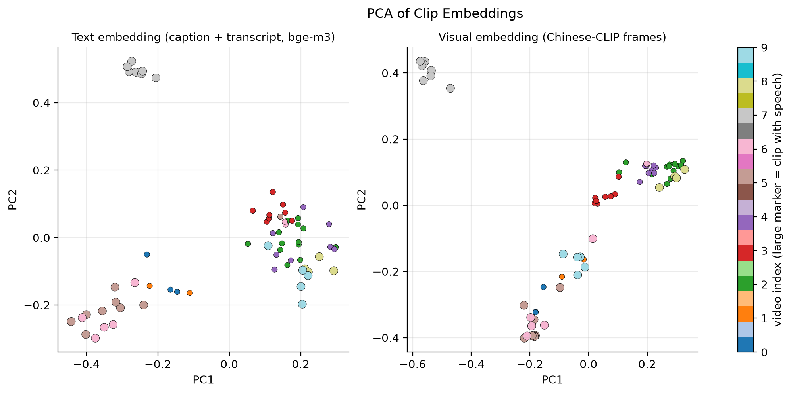

**多輪 Demo**（top-3，α = 0.6）

| 輪 | 問題 | 改寫後查詢 | 結果 |
|---|---|---|---|
| 1 | 有沒有影片在教 Excel 計算平均值或最大值？ | — | ✔ 前 2 名正是 AVERAGE / MAX 影片的開頭 clip，都被引用 |
| 2 | 那個函數要怎麼輸入？ | Excel 中的 AVERAGE 函數和 MAX 函數要怎麼輸入？ | ✔ 分別說明 `=AVERAGE(B2:B6)`、`=MAX(C2:C6)`；但標註的時間戳與引用片段不一致 |
| 3 | 有哪支影片在講解 RAG？它主要在解決什麼問題？ | （話題切換） | ✔ 前 3 名都是 RAG 影片，融合分數最高（2.55–2.72） |
| 4 | 有沒有影片在示範螢幕錄影？第一步要做什麼？ | — | ✔ iPhone 錄影影片排第 1，回答「進入設定並選擇控制中心」；文字 z 分數 2.50 遠高於視覺 1.28，靠的是逐字稿 |

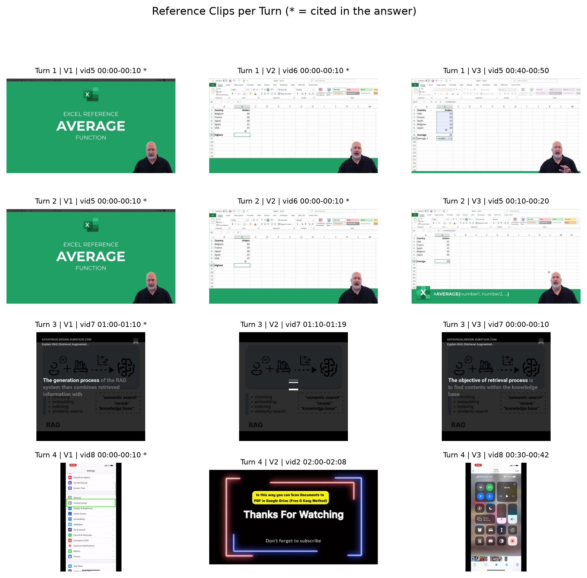

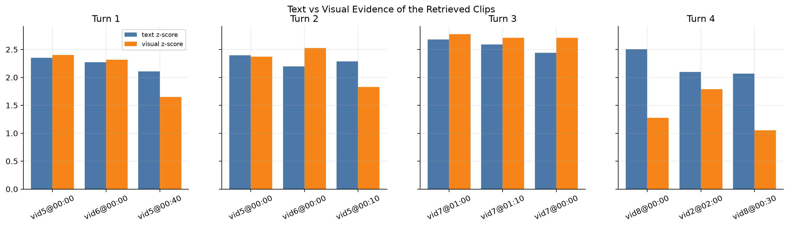

**UI**：聊天 + 參考片段（有 ffmpeg 時自動剪出被引用的 clip 播放）+ 參考畫面圖庫 + 融合分數。

**限制**：影片為網路上的教學影片，不是自行錄製；VLM 有時自行編造時間戳（第 2 輪）。

---

## Quiz 3：評估 RAG 系統

### A. 文字 RAG（Quiz 1）

RAGAS 四個核心指標 + answer correctness + 以黃金證據計算的 Hit / MRR，在 60 題上評估（最佳設定 c150 / o50 / k8、grounded_strict）：

| Hit | MRR | Context precision | Context recall | Faithfulness | Answer relevancy | Answer correctness |
|---|---|---|---|---|---|---|
| **1.000** | 0.726 | 0.803 | 0.828 | 0.858 | **0.763** | **0.903** |

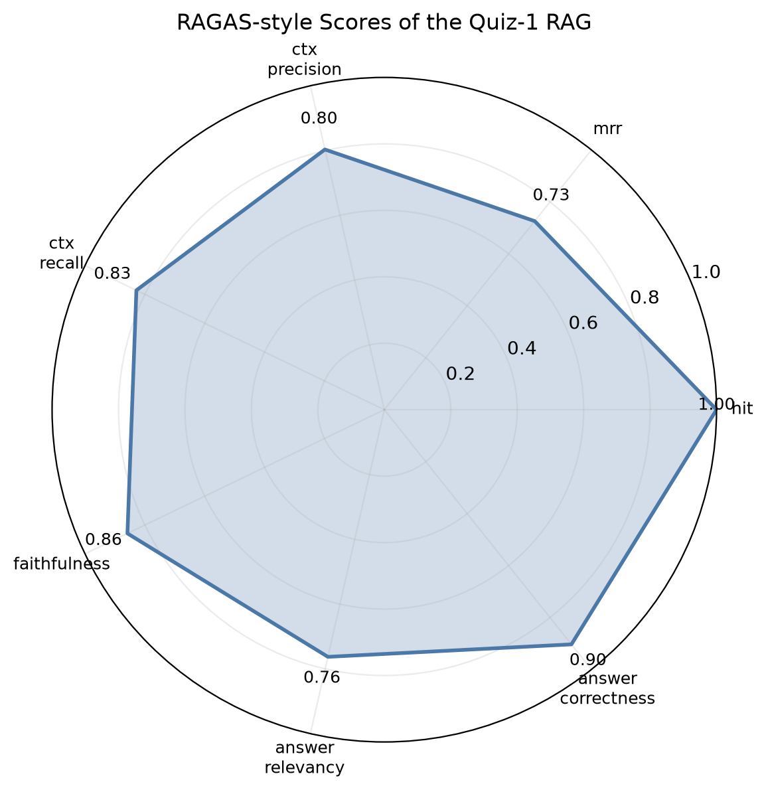

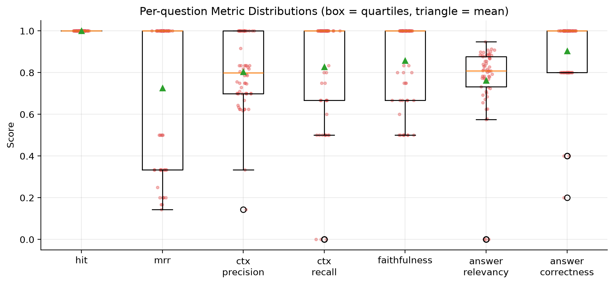

**多輪：查詢改寫是否有用？**（26 組代名詞追問 + 12 組換主題）

| 追問處理方式 | 代名詞追問 Hit / MRR | 換主題 Hit / MRR | 全部 Hit | 全部 Correctness |
|---|---|---|---|---|
| no_rewrite（直接用追問） | 0.308 / 0.213 | **1.000 / 0.750** | 0.526 | 0.642 |
| history_concat（串接歷史） | **0.846 / 0.526** | 0.250 / 0.047 | 0.658 | 0.637 |
| **llm_rewrite（LLM 改寫）** | 0.808 / 0.500 | **1.000** / 0.720 | **0.868** | 0.726 |
| oracle_standalone（標準獨立問題） | 0.769 / 0.526 | 1.000 / 0.750 | 0.842 | **0.763** |

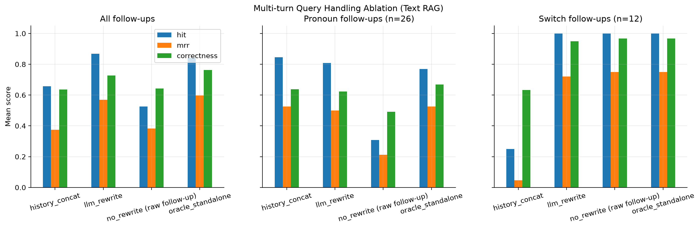

**結論**
- **檢索已飽和，瓶頸在生成端**：hit = 1，但 answer relevancy（0.76）與 context precision（0.80）最低，模型常補充與問題無關的說明。答案正確度最低的 8 題 hit 都是 1，原因包括誤拒答、沒有直接回答，以及 judge 偏嚴（等價公式、多列資訊也被扣分）。
- 與第一次執行（10 篇、未過濾 QA）相比，faithfulness 從 0.76 升到 0.86、MRR 從 0.83 降到 0.73：語料變大讓排序變難，QA 過濾讓答案更貼近證據（兩者同時改變，無法完全分開歸因）。
- **多輪**：直接拿代名詞追問檢索 Hit 只有 0.31；**歷史串接只在同主題時有效**，換主題時崩潰到 0.25；**LLM 改寫在兩種情況都穩定**，整體 Hit 0.868 最高。只有同主題追問的資料集會高估歷史串接。

### B. VideoRAG 延伸評估

延伸 RAGAS 的想法：依問題模態分層（speech / visual）、時間容忍的 clip 命中（near hit = 正確 clip ± 1）、模態消融與 α 掃描、以**原始畫面**為證據的視覺 faithfulness、引用正確率、多輪改寫消融。Benchmark 由 VLM 出題：語音題看逐字稿、視覺題直接看畫面（silver label，共 40 題）。

| 檢索方式 | speech MRR | speech Near Hit@3 | visual MRR | visual Near Hit@3 | all Near Hit@3 |
|---|---|---|---|---|---|
| visual_only（CLIP） | 0.399 | 0.55 | 0.452 | 0.55 | 0.550 |
| text_only（bge-m3） | **0.769** | 0.85 | 0.532 | 0.80 | 0.825 |
| **fusion α = 0.7** | 0.752 | **0.90** | **0.552** | **0.90** | **0.900** |

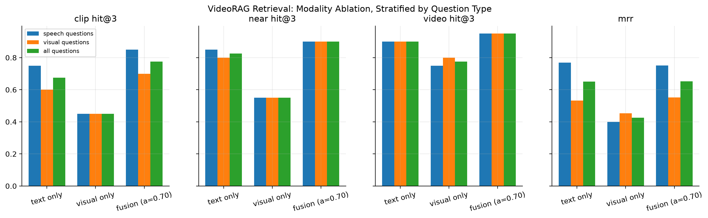

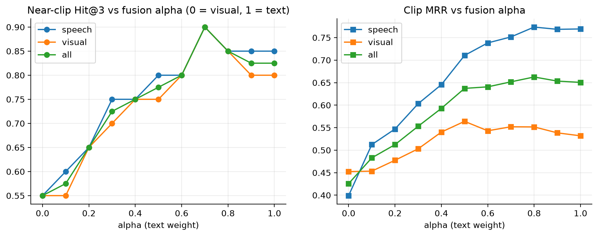

| 生成輸入 | speech 正確度 | visual 正確度 | visual 拒答率 | visual faithfulness |
|---|---|---|---|---|
| full（畫面 + 文字） | 0.63 | 0.42 | 0.60 | **0.250** |
| text_only | **0.65** | **0.46** | 0.50 | 0.000 |
| frames_only | 0.49 | 0.44 | **0.40** | 0.000 |

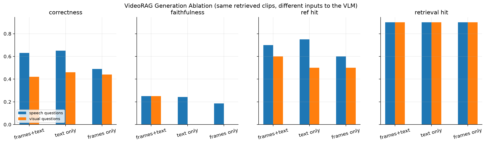

**結論**
- **speech 題主要靠文字**（純文字 MRR 0.769，純視覺 0.399），**visual 題融合幫助最大**（Near Hit@3 從 0.80 / 0.55 提升到 0.90）。α 掃描中，speech 題的 MRR 隨文字權重單調上升，visual 題在 α = 0.5 最高；α = 0.7 是兩者的折衷，若能先判斷問題模態可用不同的 α。
- **生成端**：speech 題有逐字稿時正確度 0.63–0.65，只給畫面降到 0.49；visual 題正確度只有 0.42–0.46、拒答率 40–60%，而檢索命中率是 0.90，問題出在生成與題目品質。只有 full 模式的 visual 答案能被原始畫面驗證（faithfulness 0.25）。
- **多輪改寫**（只有 7 題合格的代名詞追問）：直接用追問 Near Hit@3 0.29、VLM 改寫 0.43、標準獨立問題 0.71、歷史串接 1.00。趨勢與文字 RAG 一致，但 Qwen2.5-VL 的改寫能力明顯比文字 LLM 弱。

**限制**：每種模態只有 20 題，部分題目含「第三張圖片」「這個公式」等指代；VLM 很難產生合格的代名詞追問（80 次嘗試中 73 次不合格），影片多輪題只有 7 題。這些 silver label 需要人工修正、擴充後才能作為 gold benchmark。

---

## Quiz 4：GraphRAG

**流程**：論文 PDF（移除 References，29,826 字）→ 34 個 chunk（1,200 字、overlap 150）→ Qwen2.5-7B 抽取實體 / 關係 → 合併近似重複實體（11 組）→ networkx 圖（**155 節點、163 邊**）→ Louvain 社群（**28 個**）→ 社群摘要。

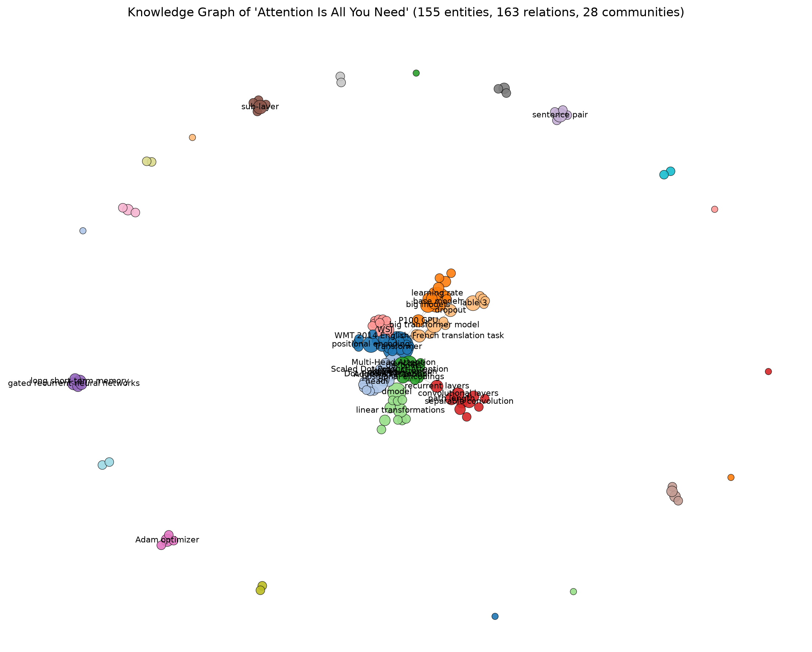

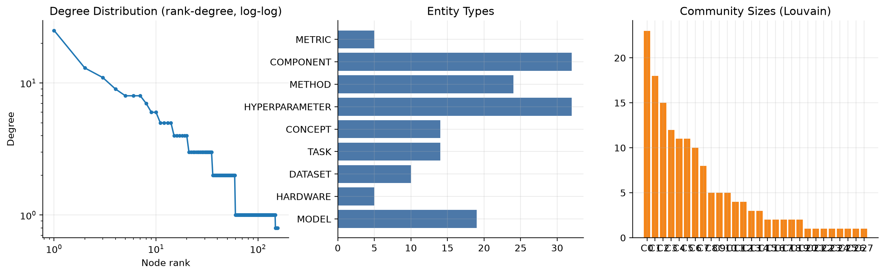

- 度數最高的是 Transformer（25），其次為 attention head、base model、Self-Attention、Multi-Head Attention，符合論文核心。實體類型以 COMPONENT 與 HYPERPARAMETER 最多。
- 抽取雜訊：`headi`、`dmodel` 是 PDF 下標遺失所造成；社群摘要中也有幻覺（例如稱 base model 有 12 層，論文為 6 層）。圖不連通，28 個社群中有 8 個只有 1 個節點。

**問答模式**
- `naive`：向量 RAG 基準。
- `local`：從問題找出種子實體，展開子圖。
- `global`：對社群摘要做 map-reduce。
- `hybrid`：local 子圖 + 向量片段。

**Benchmark**：25 題，包含 15 題單點事實、6 題多跳、4 題全域摘要（`Data/q4_benchmark.json`），以本地 LLM-judge（1–5 分）評分。

| 模式 | judge | 正確率（judge ≥ 4） | token F1 | 延遲 |
|---|---|---|---|---|
| naive | 4.32 | 0.84 | 0.407 | 1.26 s |
| local | 4.36 | 0.88 | 0.397 | 1.45 s |
| global | 3.52 | 0.72 | 0.291 | 8.44 s |
| **hybrid** | **4.68** | **0.96** | **0.414** | 1.89 s |

| 題型 | naive | local | global | hybrid |
|---|---|---|---|---|
| single（15） | 4.67 | 4.47 | 3.33 | **4.73** |
| multi（6） | 4.00 | 4.50 | 4.00 | **4.83** |
| global（4） | 3.50 | 3.75 | 3.50 | **4.25** |

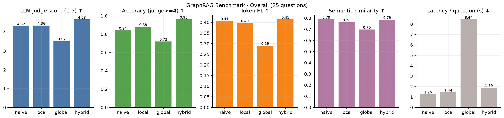

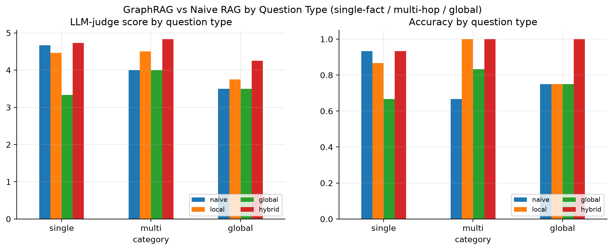

**結論**
- **hybrid 在三類題目都最好**（25 題答對 24 題）；圖結構與原文片段互補，延遲只比 naive 多約 0.6 秒。
- local 在**多跳題**明顯優於 naive（4.50 vs 4.00），顯示圖結構有助於串連分散的事實。範例多跳題 d_k = d_model / h = 512 / 8 = 64，naive、local、hybrid 都答對，global 回答含糊。

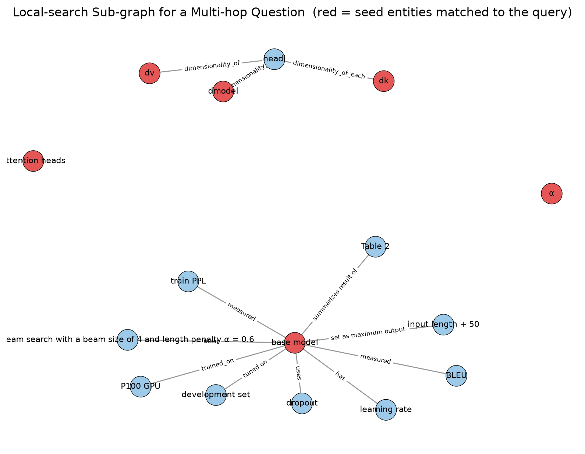

- local 答錯的 3 題都反映「只看圖」的缺點：論文 Table 3 比較過 learned positional embedding，抽取時卻變成「Transformer 使用 learned embedding」，誤導了回答（論文實際用 sinusoidal）；label smoothing ε = 0.1 沒被抽成實體；全文摘要題的種子實體落在 WSJ 實驗上。
- **global 最差且最慢**：社群摘要有幻覺且失去數值細節，在只有 34 個 chunk 的單篇論文上，社群摘要的優勢沒有發揮出來。
- 標準答案依論文內容手寫，報告前應再對照原文確認一次。

---

## 已知限制

1. 所有 LLM-judge 都由生成用的同一個 Qwen2.5-7B 擔任，分數可能偏高；QA 與影片題目都是 LLM / VLM 產生的 silver label。
2. Quiz 2 的影片是網路教學影片，不是自行錄製。
3. 樣本數小（Q1 端到端 60 題、Q3-B 每種模態 20 題、影片多輪 7 題、Q4 25 題），小幅差異不具統計顯著性。

## 輸出檔案（`Outputs/`）

| Quiz | 圖片 | 索引 / 模型 | 結果表 |
|---|---|---|---|
| 1 | `Q1_corpus_chars_per_document.png`、`Q1_chunk_length_distribution.png`、`Q1_chunk_embedding_tsne.png`、`Q1_qa_dataset_statistics.png`、`Q1_demo_retrieval_scores.png`、`Q1_grid_hit_heatmaps.png`、`Q1_grid_hit_vs_topk.png`、`Q1_grid_stability_scatter.png`、`Q1_end2end_top_configs.png`、`Q1_prompting_technique_comparison.png` | `q1_index.npz` + `q1_index_chunks.json`、`q1_index_default.*`、`q1_best_config.json` | `q1_grid_summary.csv`、`q1_prompting_results.csv`、`q1_demo_conversation.json` |
| 2 | `Q2_video_corpus_overview.png`、`Q2_frame_samples.png`、`Q2_clip_embedding_space.png`、`Q2_demo_fusion_scores.png`、`Q2_multiturn_reference_frames.png` | `q2_videorag_index.npz` + `q2_videorag_index_clips.json` | `q2_demo_conversation.json` |
| 3 | `Q3_ragas_radar.png`、`Q3_ragas_metric_distributions.png`、`Q3_hit_vs_generation.png`、`Q3_correctness_by_document.png`、`Q3_multiturn_rewrite_ablation.png`、`Q3_video_retrieval_by_modality.png`、`Q3_video_alpha_sweep.png`、`Q3_video_generation_ablation.png`、`Q3_video_multiturn_rewrite_ablation.png` | — | `q3_ragas_results.csv`、`q3_text_multiturn.csv`、`q3_video_retrieval_summary.csv`、`q3_video_generation_results.csv` |
| 4 | `Q4_graph_overview.png`、`Q4_graph_statistics.png`、`Q4_local_search_subgraph.png`、`Q4_benchmark_overall.png`、`Q4_benchmark_by_category.png` | `q4_graph.json`、`q4_graph.graphml`、`q4_embeddings.npz`、`q4_chunks.json` | `q4_benchmark_results.csv` |
