# Week 4 — NLP & Vision（Sentiment Analysis / ViT vs ResNet / Image Captioning）

## 專案簡介

| 題目 | 主題 | 重點 |
| ----- | --------- | -------------------------------------------------------------------------------- |
| Quiz1 | 資料集準備 | Yelp Review Full（3 類情感）、CUB-200-2011（200 類鳥類）、Flickr8k（影像描述），並輸出分佈與樣本圖 |
| Quiz2 | Sentiment Analysis | 以相同設定訓練 RNN 與 LSTM，比較 Accuracy、Macro-F1、Macro-AUC 與嚴重錯誤率；加做不同序列長度的對照實驗 |
| Quiz3 | Vision Transformer | 在 CUB-200-2011 細粒度分類上微調 ViT-B/16 與 ResNet-50，以 Macro-AUC、Top-1/Top-5 accuracy 比較，並分析每類別表現與最常混淆的鳥種 |
| Quiz4 | Image Captioning | 自訓練 CNN+LSTM 與預訓練 BLIP 比較 BLEU-4、BERTScore、延遲，並用 Gemini 判斷描述是否符合影像 |

> 完整的設定表、逐段結果分析與結論請見 `main.ipynb`（notebook 內含所有程式碼、圖片輸出與分析文字，本檔案僅作專案導覽與環境設置用）。

## 專案結構

```
week4
├── main.ipynb               # 含完整分析報告
├── requirements.txt
├── .env                     # 自行建立，放 GEMINI_API_KEY（不要上傳）
├── Codes/
│   ├── Quiz1.py             # 資料集準備（Yelp / CUB-200-2011 / Flickr8k）
│   ├── Quiz2.py             # RNN vs LSTM（Yelp 3 類）
│   ├── Quiz3.py             # ViT vs ResNet（CUB-200-2011，200 類）
│   └── Quiz4.py             # Image Captioning + Gemini 評判
├── Data/                    # 第一次執行 Quiz1 時自動下載與快取
│   ├── yelp/                # train_3class.csv、test_3class.csv
│   ├── cub/                 # cub_256.npz
│   └── flickr8k/            # images/、captions.json、feats_resnet50.pt
└── Outputs/                 # 圖片 Q{n}_*.png、模型 q{n}_*.pt、結果 q{n}_*.csv
```

## Environment

OS: Linux（NVIDIA GPU，使用 CUDA）
Python: 3.11

> 實驗在 Linux 叢集的 GPU 環境執行。Notebook 的專案根目錄取自 `Path.cwd()`，所以**必須從 `week4` 目錄啟動 Jupyter**。

### Setup

#### 1. Clone the repository

```
git clone <repository-url>
cd MMIP/week4
```

#### 2. Create a virtual environment with Python 3.11

Create the virtual environment:

```
python3.11 -m venv .venv
```

Activate the virtual environment:

```
source .venv/bin/activate
```

Verify the Python version:

```
python --version
```

Expected output:

```
Python 3.11.x
```

#### 3. Install Week 4 dependencies

PyTorch 請先依你的 CUDA 版本到 https://pytorch.org 取得對應安裝指令，再安裝其餘套件：

```
pip install -r requirements.txt
```

#### 4. 設定 API 金鑰與資料來源

- **Gemini（Quiz4 評判用）**：在 `week4/.env` 建立一行

  ```
  GEMINI_API_KEY=你的金鑰
  ```

  Notebook 預設使用的模型名稱在 4 開頭的設定 cell（`GEMINI_MODEL`），若該模型不可用請改成目前可用的 Gemini 模型。
- **CUB-200-2011（Kaggle `wenewone/cub2002011`）**：以 `kagglehub` 下載。若匿名下載失敗，請設定 `KAGGLE_USERNAME` 與 `KAGGLE_KEY` 環境變數。程式會自動尋找官方的 `images.txt`、`train_test_split.txt` 等檔案；找不到時退回資料夾結構並自行做每類 50% 的分層切分（會印出警告）。
- **Yelp / Flickr8k**：由 HuggingFace `datasets` 自動下載（`Yelp/yelp_review_full`、`jxie/flickr8k`），不需金鑰。
- 第一次執行 Quiz1 會下載資料並快取到 `Data/`，Flickr8k 會寫入 8,000 張圖片，需要數分鐘。

### Run Project on Jupyter Notebook

Enter the `week4` directory, then:

```
jupyter notebook
```

Open:

```
week4/main.ipynb
```

> `main.ipynb` 開頭的第一個 code cell 是 Colab 版的 Drive 掛載程式碼（已註解成字串），本機執行不需要。其餘 cell 由上往下執行即可。

### Environment Verification

```
python --version
pip list
python -c "import torch; print(torch.cuda.is_available())"
```

最後一行應印出 `True`（Quiz3、Quiz4 在 CPU 上會非常慢）。

---

## 重點摘要

以下僅列各題的關鍵數據與結論，完整推導與逐段分析請見 `main.ipynb` 對應段落。所有實驗皆為**單一隨機種子（42）**，小幅差距不宜視為統計上顯著。

### Quiz1：資料集準備

| 任務 | 資料集 | 規模 |
| --- | --- | --- |
| Sentiment Analysis | Yelp Review Full → 3 類（1–2 星 negative、3 星 neutral、4–5 星 positive，各類數量相同） | 訓練 90,000、測試 30,000；評論平均 136 字、中位數 101 字 |
| Image Classification | CUB-200-2011，200 種鳥類；沿用官方切分，官方訓練集再切 90/10 為 train/val，官方測試集為測試 | train 5,394、val 600、test 5,794（官方訓練集共 5,994）；每類約 30 張訓練圖；影像 resize 為 256×256，訓練裁切 224 |
| Image Captioning | Flickr8k，沿用官方切分，每張 5 句描述 | train 6,000、val 1,000、test 1,000 |

- 輸出：`Q1_yelp_label_dist.png`、`Q1_yelp_length_hist.png`、`Q1_cub_samples.png`、`Q1_cub_label_dist.png`、`Q1_flickr8k_samples.png`、`Q1_flickr8k_caption_length.png`

#### Quiz1 圖表

<p align="center">
  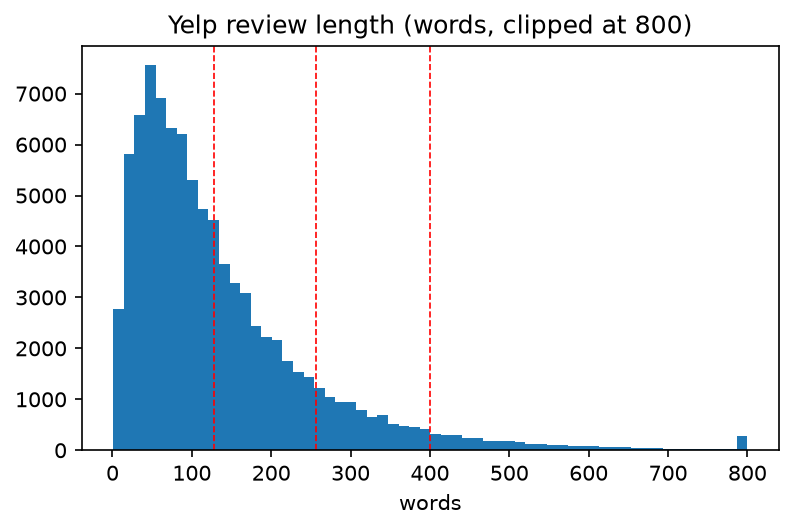
  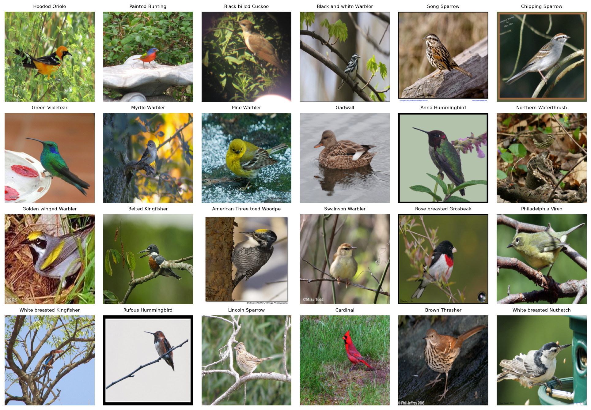
</p>
<p align="center">
  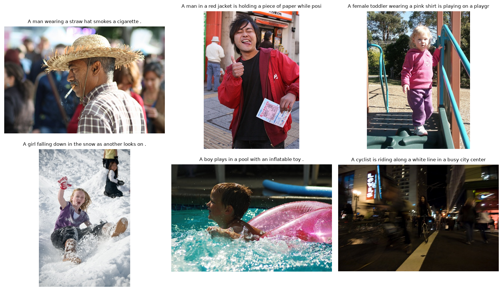
</p>

<sub>左上：Yelp 評論長度分佈（紅線為 128 / 256 / 400）；右上：CUB 的 24 個隨機鳥種樣本；下：Flickr8k 樣本與描述。</sub>

**小結**
- Yelp 評論長度偏長尾，中位數約 101 字、75% 分位數 178 字，所以序列長度 256 已涵蓋大多數評論，也是 Quiz2 長度實驗要比較 64～400 的原因。
- CUB 每類只有約 30 張訓練圖，且類別之間外觀很接近，是細粒度分類，難度明顯高於一般場景分類。
- Flickr8k 每張圖有 5 句人工描述，適合以多參考的方式計算 BLEU 與 BERTScore。

### Quiz2：RNN vs LSTM（Yelp 3 類）

設定：詞表 20,000、序列長度 256、Embedding 128、單層單向循環層（hidden 128）、Dropout 0.3、Adam lr 1e-3、early stopping（val loss，patience 5，上限 30 epochs）。RNN 與 LSTM 僅差循環單元。

| 模型 | Accuracy | Macro-F1 | Macro-AUC | 嚴重錯誤率 | 參數量 | 最佳 / 實際 epoch |
| --- | --- | --- | --- | --- | --- | --- |
| RNN | 0.6607 | 0.6535 | 0.8309 | 4.28% | 2.59 M | 13 / 18 |
| LSTM | **0.7414** | **0.7423** | **0.8958** | **1.85%** | 2.69 M | 7 / 12 |

- LSTM 在所有指標上都明顯較佳，差距主要在最模糊的 neutral 類別（recall 0.66 對 0.46）；RNN 的 val loss 起伏大，收斂較慢。
- 序列長度實驗（64 / 128 / 256 / 400，patience 2）：兩個模型都隨長度增加而進步，LSTM 在每個長度都領先 8.8–12.6 個百分點，但差距並未隨長度單調擴大，因此**不能**推論「序列越長 RNN 越差」。
- 輸出：

| 檔案 | 說明 |
| --- | --- |
| `Q2_training_curves.png` | RNN / LSTM 的 loss 與 accuracy 曲線 |
| `Q2_confusion_matrix.png` | 列正規化混淆矩陣 |
| `Q2_roc_curve.png` | 三類 OvR ROC |
| `Q2_metrics_bar.png`、`Q2_per_class_f1.png` | 整體指標與每類 F1 |
| `Q2_length_experiment.png` | 序列長度對照 |
| `q2_rnn.pt`、`q2_lstm.pt`、`q2_vocab.json` | 模型權重與詞表 |
| `q2_metrics.csv`、`q2_length_experiment.csv`、`q2_test_predictions.csv` | 結果表與測試集預測 |

#### Quiz2 圖表

<p align="center">
  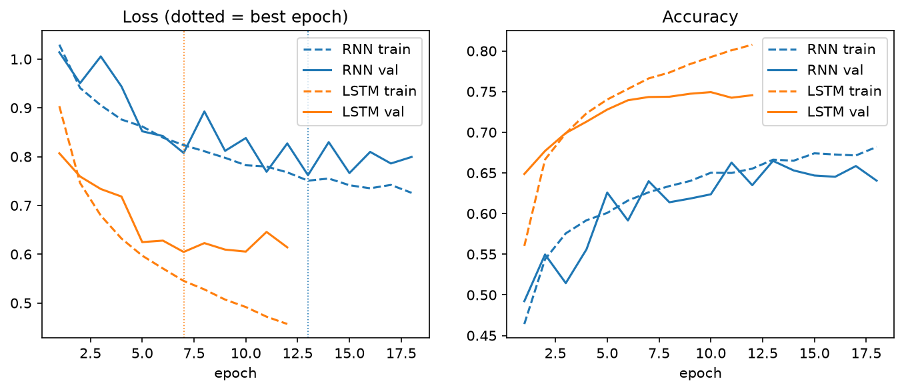
  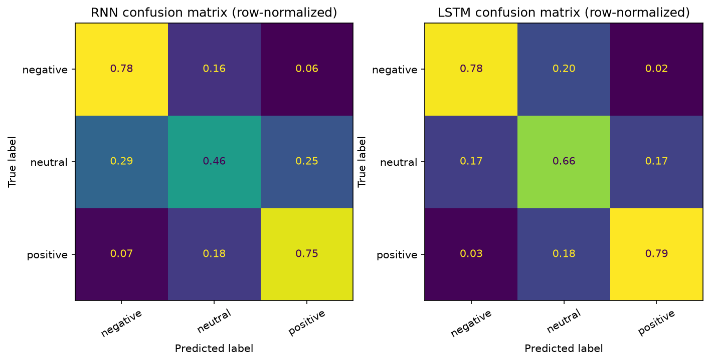
</p>
<p align="center">
  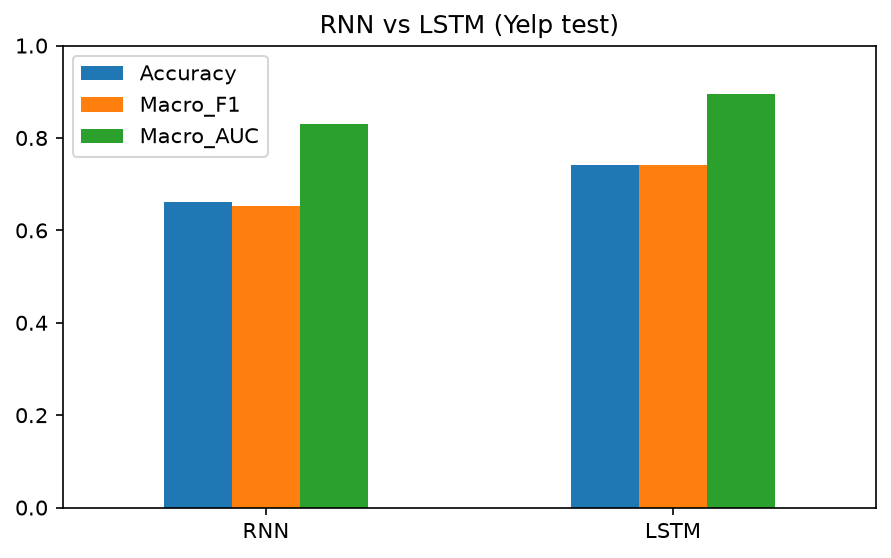
  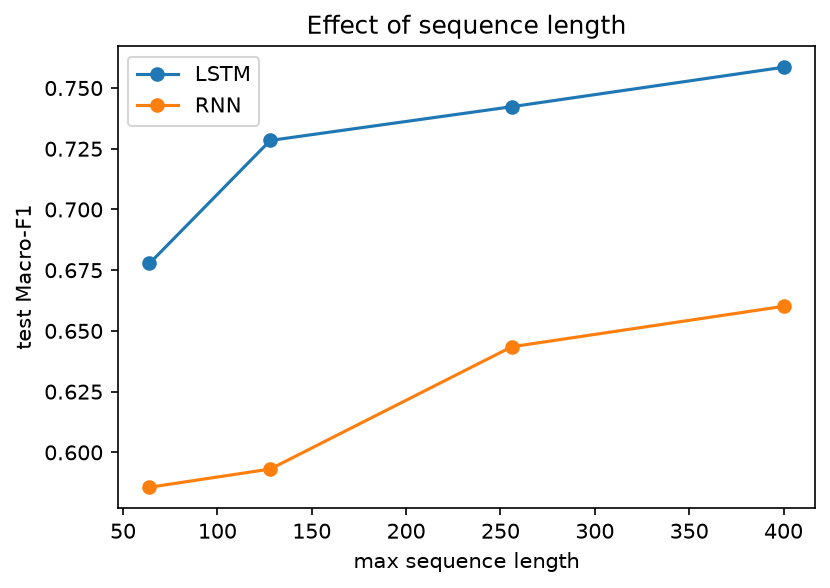
</p>

<sub>左上：訓練 / 驗證曲線；右上：列正規化混淆矩陣；左下：整體指標；右下：序列長度對照。</sub>

**小結**
- LSTM 的驗證曲線較平滑、較早（第 7 個 epoch）達到最佳；RNN 的 val loss 起伏大，到第 13 個 epoch 才達到最佳。
- 混淆矩陣顯示 negative 與 positive 的 recall 兩者接近，LSTM 的優勢主要來自 neutral（recall 0.66 對 0.46）。
- 兩個模型都隨序列變長而進步，LSTM 在每個長度都領先 RNN 8.8–12.6 個百分點。

### Quiz3：ViT vs ResNet（CUB-200-2011，200 類）

設定：兩者皆為 ImageNet 預訓練、完整微調；AdamW（weight decay 0.05）、ReduceLROnPlateau、混合精度 fp16、batch 64；骨幹學習率 ViT 3e-5、ResNet 1e-4，分類頭學習率為骨幹的 10 倍（200 類的新分類頭需要更快更新）；early stopping（val loss，patience 5，上限 30 epochs）。

| 模型 | Top-1 Acc | Top-5 Acc | Macro-F1 | **Macro-AUC** | 參數量 | 最佳 / 實際 epoch | 訓練時間 |
| --- | --- | --- | --- | --- | --- | --- | --- |
| ViT-B/16 | **0.8217** | **0.9563** | **0.8222** | 0.9957 | 85.95 M | 17 / 22 | 365 s |
| ResNet-50 | 0.7970 | 0.9505 | 0.7980 | **0.9964** | 23.92 M | 14 / 19 | 143 s |

- ViT 的 Top-1 與 Macro-F1 領先約 2.5 個百分點（約多答對 143 張）；Top-5 幾乎打平（差 0.6 個百分點）。
- Macro-AUC 兩者都超過 0.995，差距僅 0.0007 且順序與 Top-1 相反，在 200 類下無法區分模型，比較應以 Top-1、Top-5 與 Macro-F1 為主。
- 兩個模型最難的類別高度重疊（海鷗、燕鷗、烏鴉等外觀相近的類群，平均準確率約 0.33–0.47）；錯誤集中在同一類群內的相似物種之間。
- ViT 的參數量是 ResNet 的 3.6 倍，訓練時間約 2.6 倍。兩個模型都嚴重過擬合（train loss 約 0.012，val loss 0.71 / 0.87），early stopping 分別在第 22、19 個 epoch 停止。
- 限制：單一隨機種子；驗證集僅約 3 張/類，val 指標雜訊大；兩個模型的預訓練權重版本不同（`IMAGENET1K_V1` 對 `IMAGENET1K_V2`）；ImageNet 預訓練本身含鳥類類別。
- 200 類無法逐類畫 ROC 與標示混淆矩陣，改用巨觀平均 ROC、去除對角線的錯誤熱圖、最難的 15 個類別，以及最常被混淆的鳥種對。
- 輸出：

| 檔案 | 說明 |
| --- | --- |
| `Q3_training_curves.png` | 訓練 / 驗證 loss、accuracy、Macro-AUC |
| `Q3_auc_comparison.png` | 每類別 AUC 的分佈與 ViT 對 ResNet 散點圖 |
| `Q3_roc_curves.png` | 巨觀平均 ROC（含低 FPR 放大） |
| `Q3_confusion_matrix.png` | 去除對角線的錯誤熱圖 |
| `Q3_worst_classes.png` | 兩模型平均 accuracy 最低的 15 個類別 |
| `Q3_prediction_examples.png` | 隨機 10 張測試圖的預測（任一模型答錯則標題為紅色） |
| `q3_vit.pt`、`q3_resnet.pt` | 模型權重 |
| `q3_metrics.csv`、`q3_per_class.csv`、`q3_top_confusions.csv` | 整體結果、每類別 AUC 與 accuracy、最常混淆的類別對 |

#### Quiz3 圖表

<p align="center">
  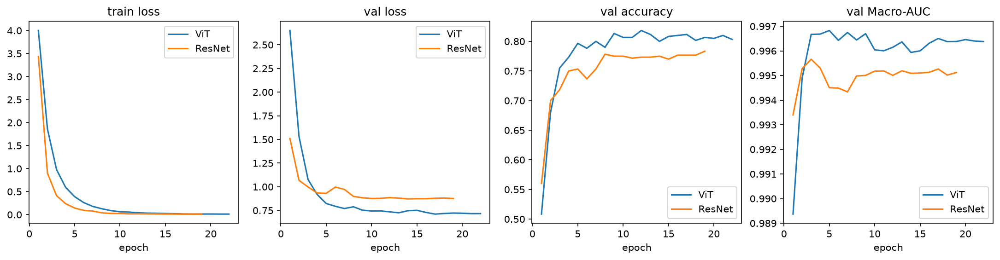
  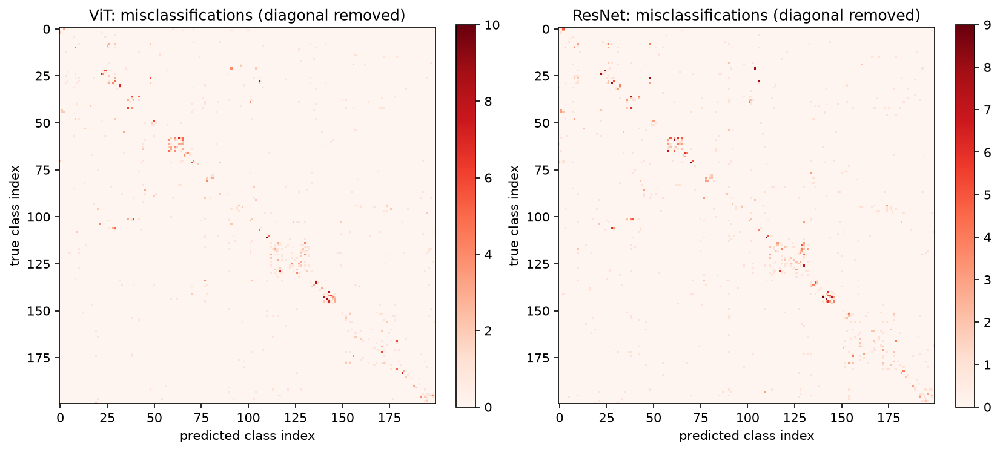
</p>
<p align="center">
  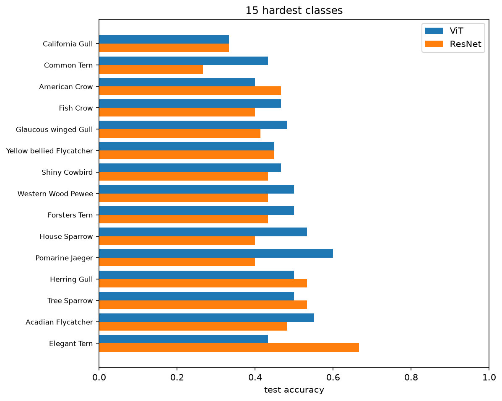
  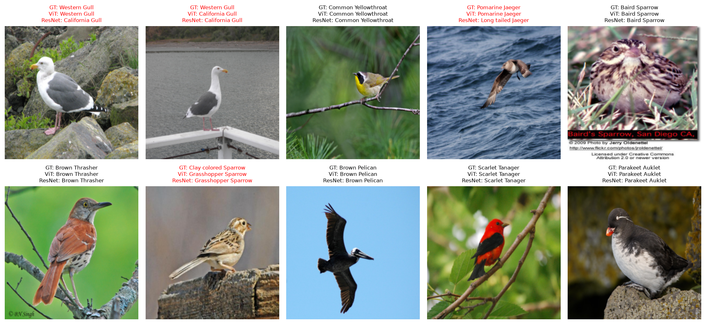
</p>

<sub>左上：訓練曲線（loss、val accuracy、Macro-AUC）；右上：去除對角線的錯誤熱圖（左 ViT、右 ResNet）；左下：兩模型平均 accuracy 最低的 15 個類別；右下：隨機 10 張測試圖的預測（標題為紅色代表至少一個模型答錯）。</sub>

**小結**
- 兩個模型的 train loss 都降到約 0.012，val loss 卻停在 0.71（ViT）與 0.87（ResNet），過擬合明顯，early stopping 在第 22、19 個 epoch 停止。
- 錯誤熱圖顯示錯誤集中在對角線附近的方塊。CUB 的類別編號依鳥類名稱分組，所以這代表錯誤主要發生在同一類群內的相似物種之間。
- 最難的類別以海鷗、燕鷗、烏鴉、鶲與麻雀為主，兩個模型高度重疊，但優劣並不一致（例如 Pomarine Jaeger 是 ViT 較好，Elegant Tern 是 ResNet 較好）。
- 隨機 10 張預測中 ViT 答對 8 張、ResNet 答對 6 張，答錯的都是近緣物種（Western Gull → California Gull、Pomarine Jaeger → Long tailed Jaeger、Clay colored Sparrow → Grasshopper Sparrow）。這 10 張僅供示意，不能代表整體比較。

### Quiz4：Image Captioning

兩種方法（batch size = 1 計時圖片 → 文字的端到端時間），共用從測試集以固定種子隨機抽出的 1,000 張圖（N_EVAL = 1000，即整個 Flickr8k 測試集）：

- **A：CNN + LSTM（自訓練）**：凍結的 ResNet-50 特徵 + LSTM 解碼器（embedding 128、hidden 256、詞表 2,539 詞），貪婪解碼，early stopping 於第 21 個 epoch 停止（最佳 val loss 在第 18 個 epoch）。
- **B：BLIP（預訓練）**：`Salesforce/blip-image-captioning-base`，零樣本推論，beam search（3 beams）。
- **Gemini 只負責評判**（`gemini-3.5-flash-lite`；取評估集的前 10 張，兩個方法判斷同一批圖，`N_JUDGE = 10`），不產生描述。

| 方法 | BLEU-4 | BERTScore F1 | 平均延遲 | Gemini 符合率 | Gemini 平均分 |
| --- | --- | --- | --- | --- | --- |
| A：CNN+LSTM | 18.52 | 0.9248 | **0.0067 s** | 0.1（1/10） | 1.9 |
| B：BLIP | **28.25** | **0.9402** | 0.0757 s | **0.8（8/10）** | **4.3** |

- BLIP 在所有品質指標上都較佳（BLEU-4 高約 9.7、BERTScore 高約 0.015）；自訓練模型快約 11 倍，但這個比較含解碼方式差異（貪婪對 beam search），不全是模型大小造成。
- BERTScore 未做 baseline 縮放，數值被壓縮在 0.92–0.94，差距比數字顯示的大。
- Gemini 判斷每個方法只有 10 張，符合率各代表 1 張與 8 張；Wilson 95% 信賴區間約 0.02–0.40 與 0.49–0.94，兩者不重疊，方向有支持，但實際比例不確定。Gemini 的判斷本身也不是人工標準。
- 輸出：

| 檔案 | 說明 |
| --- | --- |
| `Q4_training_curve.png` | 解碼器訓練 / 驗證 loss |
| `Q4_method_comparison.png` | BLEU / BERTScore / Gemini 符合率 / 延遲比較 |
| `Q4_caption_examples.png` | 範例圖與兩種方法的描述（附 Gemini 判斷） |
| `q4_cnn_lstm.pt` | 自訓練解碼器權重與詞表 |
| `q4_generated_captions.csv`、`q4_gemini_judgement.csv`、`q4_results.csv` | 產生的描述、Gemini 判斷明細與結果表 |

#### Quiz4 圖表

<p align="center">
  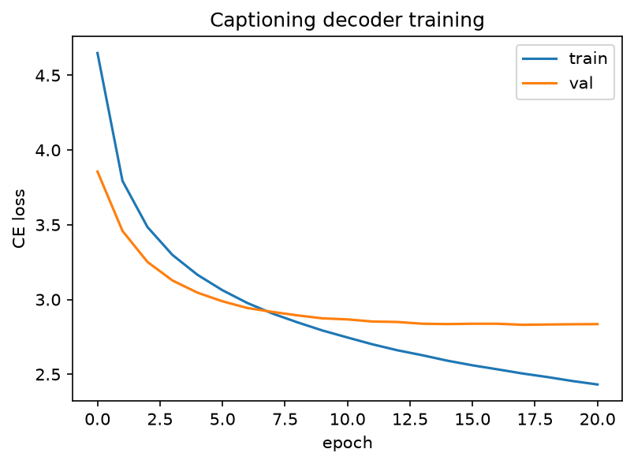
  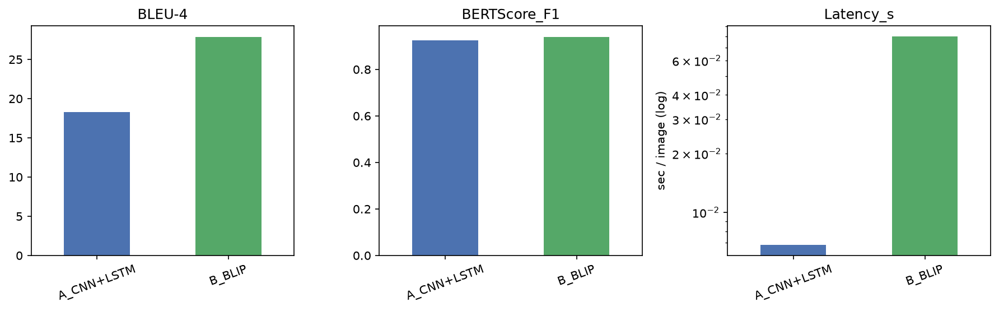
</p>
<p align="center">
  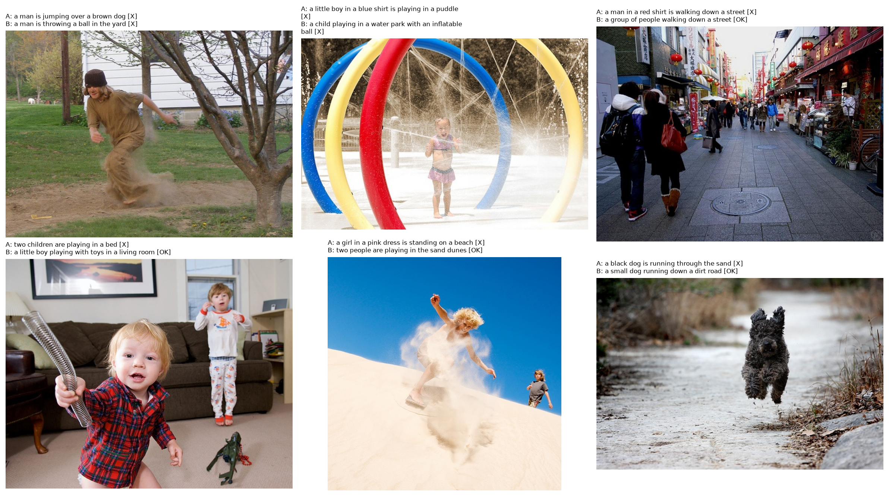
</p>

<sub>上左：解碼器訓練 / 驗證 loss；上右：兩種方法的 BLEU-4、BERTScore、Gemini 符合率與延遲（延遲為對數軸）；下：前 6 張被 Gemini 評判的圖片與兩種方法的描述（[OK] 為符合、[X] 為不符合）。</sub>

**小結**
- 解碼器的 val loss 在第 18 個 epoch 之後不再下降，train loss 持續下降，是 Flickr8k 資料量小造成的過擬合。
- 範例圖中，A（CNN+LSTM）的 6 張描述全被 Gemini 判為不符合，B（BLIP）有 4 張符合、2 張不符合；A 常能抓到場景大類，卻說錯動作與人物細節（例如把在沙丘上滑行的男孩說成站在沙灘上的粉紅洋裝女孩）。
- 範例只是被評判的 10 張中的前 6 張，整體符合率以上方表格為準。

## 整體小結

| 題目 | 比較 | 結論 |
| --- | --- | --- |
| Quiz2 | RNN vs LSTM（Yelp 三類） | LSTM 全面優於 RNN（Accuracy 0.741 對 0.661，Macro-AUC 0.896 對 0.831），差距主要在 neutral 類別，且在所有測試序列長度都領先 |
| Quiz3 | ViT vs ResNet（CUB 二百類） | ViT 的 Top-1 與 Macro-F1 領先約 2.5 個百分點，代價是 3.6 倍參數量、約 2.6 倍訓練時間；Macro-AUC 兩者都超過 0.995，無法區分 |
| Quiz4 | CNN+LSTM vs BLIP | BLIP 品質全面較佳（BLEU-4 28.25 對 18.52，Gemini 符合率 8/10 對 1/10），CNN+LSTM 延遲低約 11 倍 |

## 已知限制

1. 所有實驗皆為單一隨機種子，Quiz3 的小差距與 Quiz2 的長度實驗細節不宜過度解讀。
2. Quiz4 的 BLEU / BERTScore / 延遲基於整個測試集（1,000 張），但 Gemini 評判受 API 用量限制，僅基於每方法 10 張，結論僅具方向性。
3. `requirements.txt` 未固定版本；若需完全重現，請以實際環境的 `pip freeze` 取代。
