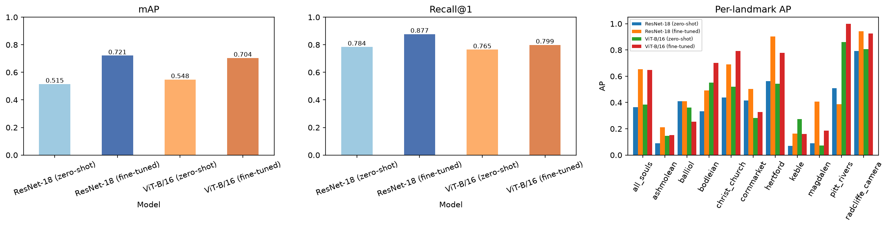
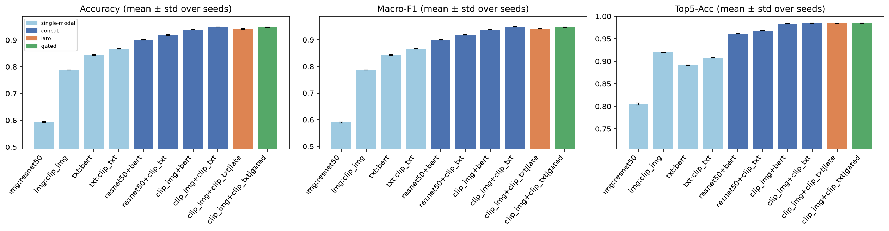
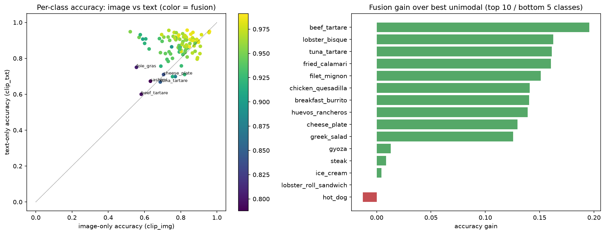
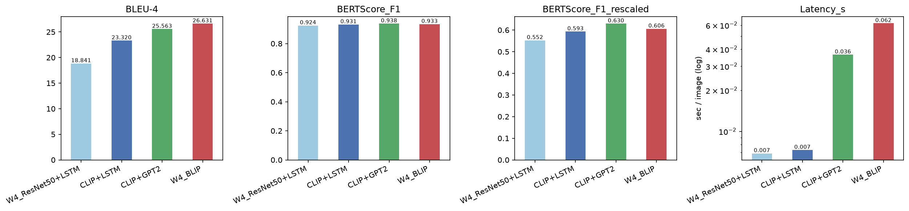
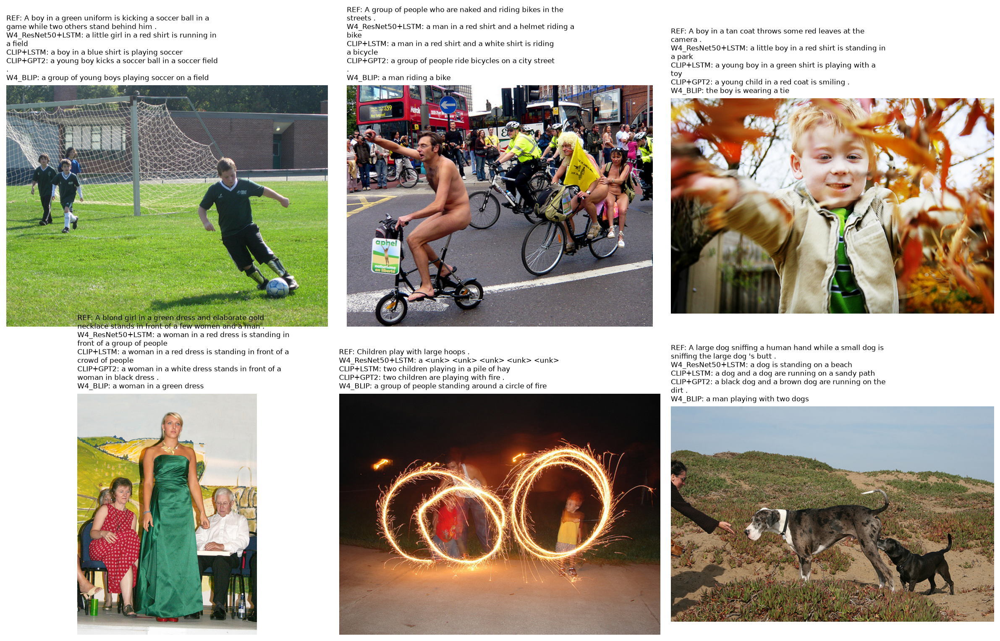

# Week 5：影像檢索、多模態分類與 CLIP Image Captioning

本週包含三個 Quiz，全部在 `main.ipynb` 依步驟分 cell 執行，核心程式放在 `Codes/`。

| Quiz | 任務 | 資料集 | 方法 | 主要結果 |
|---|---|---|---|---|
| 1 | 影像檢索 | Oxford Buildings (Oxford5k) | CNN（ResNet-18）vs ViT-B/16 | 微調後 mAP 約 0.70–0.72，CNN 略優 |
| 2 | 多模態分類（影像 + 文字） | UPMC Food-101（101 類） | 影像 / 文字 backbone 組合 + 三種融合策略 | 最佳 Accuracy 0.949（CLIP 影像 + CLIP 文字） |
| 3 | Image Captioning | Flickr8k | CLIP 編碼器 + LSTM / GPT-2，對照 Week 4 | BLEU-4 由 18.8 提升到 25.6 |

## 專案結構

```
week5/
├── main.ipynb          # 主要執行流程與每題結果分析
├── README.md
├── Codes/
│   ├── Quiz1.py        # Oxford5k 影像檢索；同時提供共用工具（set_seed、EarlyStopping、save_fig…）
│   ├── Quiz2.py       # UPMC Food-101 多模態分類
│   └── Quiz3.py        # CLIP Image Captioning
├── Data/               # 資料集（不存在時程式會自動下載或偵測）
└── Outputs/            # 所有圖片（Q{n}_*.png）、模型（q{n}_*.pt）與結果表（q{n}_*.csv）
```

## 環境與執行

- Python 3.11；主要套件：`torch`、`torchvision`、`transformers`、`datasets`、`sacrebleu`、`bert-score`、`scikit-learn`、`pandas`、`matplotlib`、`huggingface_hub`、`kagglehub`。
- 建議使用 GPU；訓練皆使用 early stopping。
- 依序執行 `main.ipynb`；每個 Quiz 分成多個 cell，可單獨重跑。特徵會快取在 `Data/`，第二次執行會直接讀取。
- Quiz 3 需要 Week 4 訓練好的 LSTM 權重：請放在 `Outputs/`（預設檔名 `q4_cnn_lstm.pt`），或用 `q3.load_week4(ctx3, path=...)` 指定實際路徑與檔名。
- 圖片內文字一律使用英文；圖片存成 `Q1_*`、`Q2_*`、`Q3_*`，模型存成 `q1_*`、`q2_*`、`q3_*`。

---

## Quiz 1：Oxford5k 影像檢索（CNN vs ViT）

**資料與評估協定**（自訂，避免訓練與測試洩漏）
- 取 11 個地標的 good+ok 影像為有標註資料，每個地標依 50% / 15% / 35% 切成 train / val / test；另抽 400 / 100 張無標註影像當「其他」類別加入 train / val，並自檢索庫移除。
- 檢索庫 = test 有標註影像 + 其餘 3,718 張 distractor（共 3,922 張）；query = 204 張 test 影像（排除自己）。
- 因此不是官方 Oxford5k 協定，數字不能直接與論文比較。

**模型**：ImageNet 預訓練的 ResNet-18 與 ViT-B/16，微調最後階段 + 256 維投影 + cosine 分類頭；另外評估 zero-shot（不微調）作對照。

| 模型 | mAP | Recall@1 | Recall@5 | 參數量 |
|---|---|---|---|---|
| ResNet-18 zero-shot | 0.515 | 0.784 | 0.877 | 11.2M |
| ResNet-18 微調後 | **0.721** | **0.877** | **0.926** | 11.2M |
| ViT-B/16 zero-shot | 0.548 | 0.765 | 0.887 | 85.8M |
| ViT-B/16 微調後 | 0.704 | 0.799 | 0.902 | 85.8M |



**結論**
- 微調確實有效：mAP 提升 ResNet-18 +0.206、ViT +0.156。zero-shot 時 ViT 略好，微調後 ResNet-18 反超。
- 兩種 backbone 差距不大（mAP 只差 0.017），僅單一 seed、204 個 query，較保守的說法是「微調後 CNN 略優，且參數量只有 ViT 的約 1/8」。
- Early stopping 最佳 epoch：ResNet-18 為 9、ViT 為 6；之後 train loss 持續下降但 val loss 不再改善，顯示小資料下很快過擬合。
- 各地標難度差異大：radcliffe_camera、hertford、christ_church 較容易，ashmolean、keble、magdalen 最難；微調也並非對每個地標都有益。

---

## Quiz 2：UPMC Food-101 多模態分類（影像 + 食譜文字）

**資料**：UPMC Food-101，每筆為一張影像加一段網頁文字，101 類。偵測到 90,704 張影像；train 再分層切出 10% 當 val，train / val / test = 61,177 / 6,795 / 22,716。程式會先找 `Data/upmc_food101/`，沒有才嘗試用 kagglehub 下載（`Quiz2.KAGGLE_ID`，尚未驗證，失敗時請手動放置資料），資料夾結構與文字格式採自動偵測。

**方法**
1. Backbone 網格（皆凍結、先抽特徵並快取）：影像 ResNet-50 vs CLIP ViT-B/16 影像編碼器；文字 BERT-base vs CLIP 文字編碼器。共 4 組單模態基準 + 4 組 concat 融合。
2. 融合策略比較（用最佳組合）：concat、late（各模態 logits 平均）、gated（學習式門控）。
3. 分析：逐類別增益、模態消融、最常被混淆的類別。
4. 每組 3 個 seed（mean ± std），early stopping 以 val Macro-F1 為準。

| 實驗 | Accuracy | Macro-F1 | Top-5 Acc |
|---|---|---|---|
| img:resnet50 | 0.592 | 0.590 | 0.805 |
| img:clip_img | 0.788 | 0.787 | 0.920 |
| txt:bert | 0.844 | 0.843 | 0.892 |
| txt:clip_txt | 0.867 | 0.867 | 0.908 |
| resnet50 + bert（concat） | 0.900 | 0.900 | 0.961 |
| resnet50 + clip_txt（concat） | 0.919 | 0.919 | 0.968 |
| clip_img + bert（concat） | 0.939 | 0.939 | 0.983 |
| **clip_img + clip_txt（concat）** | **0.949** | **0.949** | **0.985** |
| clip_img + clip_txt（late） | 0.942 | 0.942 | 0.984 |
| clip_img + clip_txt（gated） | 0.948 | 0.948 | 0.985 |



**結論**
- 多模態融合明顯優於任何單模態：最佳融合 0.949，高於最佳單模態文字（0.867）8.2 個百分點。
- Backbone 選擇有很高的鑑別度：CLIP 影像編碼器比 ResNet-50 高 19.6 個百分點；融合時影像編碼器的影響大於文字編碼器。
- 融合策略：concat（0.949）與 gated（0.948）相當，late 低約 0.7 個百分點。
- 模態消融：遮掉影像 Accuracy 降到 0.854，遮掉文字降到 0.717，模型明顯更依賴文字；融合模型訓練時未見過缺少模態的輸入，此數字應視為依賴程度，而非單模態實力。
- 錯誤集中在外觀或語意相近的類別，例如 tuna_tartare ↔ beef_tartare、sashimi ↔ sushi、gyoza → dumplings。



**限制**：seed 只改變分類頭的初始化與抽樣順序，標準差會低估整體不確定性；backbone 凍結、未微調；未檢查 train 與 test 之間是否有近重複樣本。

---

## Quiz 3：CLIP Image Captioning（Flickr8k，與 Week 4 比較）

**資料**：Hugging Face `jxie/flickr8k`，train / val / test = 6,000 / 1,000 / 1,000 張，每張 5 句參考描述（沿用 Week 4 資料集）。

**比較系統**
- `W4_ResNet50+LSTM`：載入 Week 4 訓練好的模型（不重訓），貪婪解碼，作為基準。
- `CLIP+LSTM`：只把 Encoder 換成 CLIP ViT-B/16，LSTM 解碼器架構相同（多一層輸入 LayerNorm），貪婪解碼。
- `CLIP+GPT2`：ClipCap 風格，CLIP 向量 → MLP 前綴 → DistilGPT-2（beam=3）。
- `W4_BLIP`：Week 4 的預訓練模型，作為參考。

**評估**：BLEU-4（sacrebleu、5 句參考）、BERTScore F1（原始與 rescaled）、端到端延遲（batch=1）。

| 系統 | BLEU-4 | BERTScore F1 | BERTScore (rescaled) | 平均字數 | 延遲 |
|---|---|---|---|---|---|
| W4_ResNet50+LSTM | 18.8 | 0.9245 | 0.553 | 10.8 | 6.9 ms |
| CLIP+LSTM | 23.3 | 0.9313 | 0.593 | 10.1 | 7.3 ms |
| CLIP+GPT2 | 25.6 | **0.9375** | **0.630** | 11.3 | 36.5 ms |
| W4_BLIP | **26.6** | 0.9335 | 0.606 | 6.8 | 62.0 ms |



**結論**
- 每一步改動都有提升：僅換成 CLIP 編碼器，BLEU-4 由 18.8 升到 23.3；再換成 GPT-2 解碼器升到 25.6。
- CLIP+GPT2 的 BERTScore 高於 BLIP；BLIP 的 BLEU-4 最高，但描述平均只有 6.8 字，與 Flickr8k 參考描述風格不同（推測為兩個指標排序不一致的原因）。
- CLIP+LSTM 與 Week 4 基準速度相近但品質明顯較好；CLIP+GPT2 約慢 5 倍，仍比 BLIP 快。
- 注意：CLIP+GPT2 使用 beam search，LSTM 系統使用貪婪解碼，解碼方式也是差異來源之一；兩者的 token-level loss 因分詞不同，不能直接比較；每個系統只訓練一個 seed。



---

## 輸出檔案（`Outputs/`）

| Quiz | 圖片 | 模型 | 結果表 |
|---|---|---|---|
| 1 | `Q1_dataset_overview.png`、`Q1_training_curves.png`、`Q1_method_comparison.png`、`Q1_retrieval_examples.png` | `q1_cnn.pt`、`q1_vit.pt` | `q1_results.csv`、`q1_per_landmark_map.csv` |
| 2 | `Q2_data_overview.png`、`Q2_training_curves.png`、`Q2_model_comparison.png`、`Q2_class_analysis.png`、`Q2_modality_ablation.png`、`Q2_top_confusions.png`、`Q2_predictions.png` | `q2_*.pt`（每組實驗一個，共 10 個） | `q2_results.csv`、`q2_per_class_acc.csv` |
| 3 | `Q3_training_curves.png`、`Q3_method_comparison.png`、`Q3_caption_examples.png` | `q3_clip_lstm.pt`、`q3_clip_gpt2.pt` | `q3_results.csv`、`q3_generated_captions.csv` |
