# Week 6 — LLM / VLM Quiz 1–3

Open-source LLM / VLM 的部署、評估、Prompt Engineering、量化、DPO 微調與影像畫質實驗。
所有圖片由 `main.ipynb` 產生並存於 `Outputs/`，命名為 `Q1_*`、`Q2_*`、`Q3_*`。

## 1. 專案結構

```
.
├── main.ipynb          # 主流程（每個 Quiz 分成：資料前處理 → 訓練/推論 → 結果）
├── Codes/
│   ├── common.py       # 共用：模型載入、記憶體量測、Gemini judge、LoRA + DPO trainer
│   ├── Quiz1.py        # LLM benchmark / prompting / 量化 / 記憶體
│   ├── Quiz2.py        # COCO 資料、VLM 載入、20 題視覺 benchmark
│   └── Quiz3.py        # LLM / VLM 偏好資料、DPO、MMLU、畫質擾動
├── Data/               # 資料集（不存在時自動下載）與 benchmark json
└── Outputs/            # 圖片 Q{n}_*.png、模型 q{n}_*、csv
```

## 2. 環境與執行

| 項目 | 內容 |
|---|---|
| GPU | 單卡 RTX 3090；為相容 8 GB VRAM，模型皆選 ≤ 2.2B 參數 |
| 主要套件 | torch, transformers (≥4.45), peft, bitsandbytes, datasets, google-genai |
| 商用 LLM 評估 | Gemini（`gemini-3.5-flash-lite`），`.env` 設定 `GEMINI_API_KEY` |

```bash
pip install -U torch transformers accelerate bitsandbytes peft datasets pillow pandas matplotlib tqdm google-genai python-dotenv
# .env: GEMINI_API_KEY=...   HF_TOKEN=...
jupyter notebook main.ipynb     # 依序執行；資料集（COCO val / Alpaca / MMLU）會自動下載到 Data/
```

| 用途 | 模型 |
|---|---|
| Q1 LLM / Q3 LLM | Qwen2.5-1.5B-Instruct |
| Q2 VLM A / Q3 VLM | Qwen2-VL-2B-Instruct |
| Q2 VLM B | SmolVLM-Instruct (2.2B) |

---

## 3. Quiz 1 — LLM 部署、評估、Prompting、量化

### 3.1 自訂 20 題 Instruction Benchmark
涵蓋數學、推理、中英文知識、程式（單元測試驗證）、翻譯、摘要、格式/長度/語言控制、安全拒答、常識、創作、幻覺（false premise）共 13 類。每題有自動 checker 與參考答案，另由 Gemini 評 1–10 分。

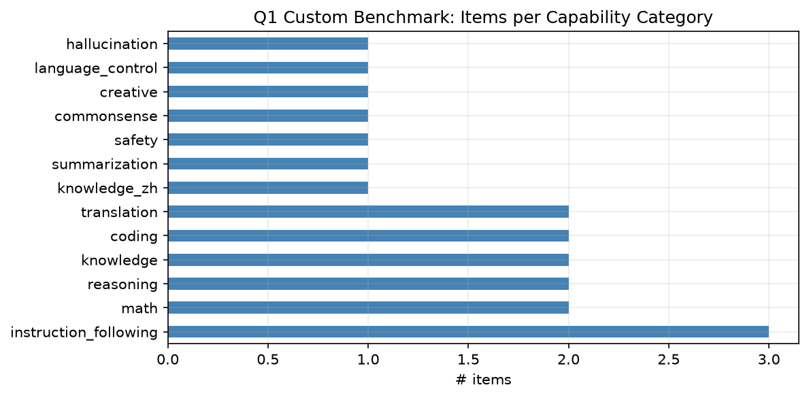

### 3.2 Prompting Techniques（bf16）

| 技巧 | 自動通過率 | Judge | 平均輸出 tokens |
|---|---|---|---|
| baseline | 0.90 | 9.55 | 85.2 |
| **role** | **0.95** | **9.75** | 57.0 |
| CoT | 0.75 | 7.75 | 92.5 |
| few-shot | 0.90 | 9.50 | 53.3 |
| combo (role + few-shot) | 0.95 | 9.50 | 40.5 |

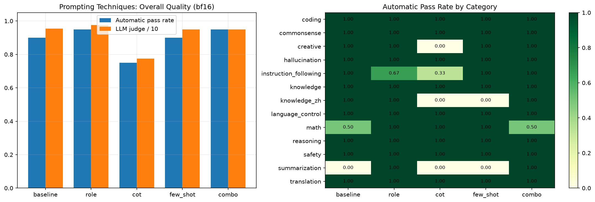

* **role 最佳**（修好第 1、12 題，第 15 題退步）。
* **CoT 最差**：多數題目有嚴格輸出格式限制，要求先推理反而違規。
* few-shot / combo 讓輸出更短，但 prompt 長 3–4 倍。

### 3.3 預設精度（bf16）的 GPU 記憶體

權重 2.88 GiB，20 題平均推理峰值 2.89 GiB（std 0.003）；推理額外開銷僅約 13 MiB。

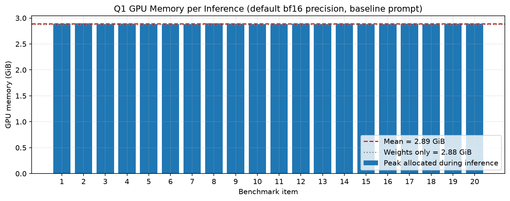

### 3.4 量化（bitsandbytes，baseline prompt）

| 精度 | 自動通過率 | Judge | tok/s | 權重 (MiB) | 平均推理記憶體 (MiB) | 相對 bf16 |
|---|---|---|---|---|---|---|
| bf16 | 0.90 | 9.55 | 106.7 | 2944 | 2958 | 100% |
| int8 | 1.00 | 9.70 | 22.6 | 1697 | 1714 | **−42%** |
| int4 (NF4) | 0.90 | 8.75 | 77.0 | 1090 | 1129 | **−62%** |

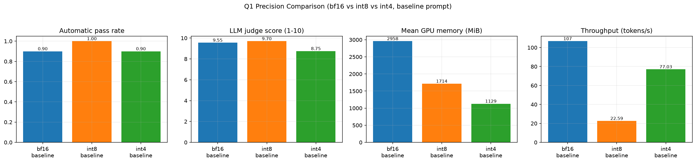

* int8 品質接近 bf16，但速度慢約 4.7 倍（bitsandbytes LLM.int8 的反量化開銷）；int4 慢約 28%，judge 下降 0.8 分。
* int4 沒有降到理論的 1/4：診斷顯示權重中 625 MiB 為 uint8（量化後 Linear），**445 MiB 的 embedding / lm_head 仍為 bf16**（約佔 41%），1.5B 小模型的 embedding 佔比很大。
* 量測注意：載入量化模型後需 `gc.collect()` 再量測，否則殘留暫存 tensor 會讓數字偏大（已在 `load_llm` 處理）。

### 3.5 最佳 Prompt + int4 vs 預設

| 設定 | 自動通過率 | Judge | 平均輸出 tokens | 平均推理記憶體 |
|---|---|---|---|---|
| bf16 + baseline（預設） | 0.90 | 9.55 | 85.2 | 2958 MiB |
| bf16 + role | 0.95 | 9.75 | 57.0 | 2957 MiB |
| int4 + baseline | 0.90 | 8.75 | 79.7 | 1129 MiB |
| **int4 + role** | **1.00** | **9.50** | 56.8 | **1130 MiB** |

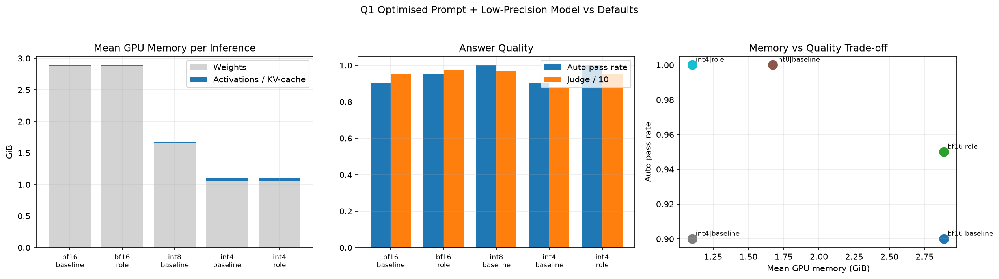

* **記憶體 2.89 → 1.10 GiB（−62%），通過率反而 0.90 → 1.00、judge 持平（9.55 → 9.50）**。
* role prompt 補回 int4 的損失（judge 8.75 → 9.50），輸出縮短約 29%，因此每題平均延遲與 bf16 預設相近（約 0.74 s vs 0.80 s，由輸出長度 ÷ 速度估算）。

---

## 4. Quiz 2 — 兩個 VLM 比較

### 4.1 為什麼有兩版 Benchmark
**v1（隨機負樣本、小計數、明顯主體）**：Qwen2-VL-2B 與 SmolVLM 在 16 題客觀題**都是 100%**（天花板效應），只有描述題（4 張圖）有差異（recall 0.625 vs 0.812、幻覺率 0.25 vs 0.00），無法有效比較。
**處理方式：保持模型不變，換成更難的題目（v2）。** 模型是作業要比較的對象，問題在題目沒有鑑別力。

### 4.2 v2 — 自訂 20 題 Hard Benchmark（COCO val，自動下載）

| 類型 | 題數 | 難點 | 指標 |
|---|---|---|---|
| Spatial left/right | 3 | 兩個單一物件的左右關係（水平不重疊） | accuracy |
| Counting (4–9) | 3 | 4–9 個物件的計數 | accuracy、count MAE |
| Prominence MCQ | 3 | **選項全是圖中存在的物件** | accuracy |
| Small-object existence | 3 | 僅佔圖 0.3–2% 的小物件 | accuracy |
| Adversarial absent | 4 | 不存在，但與圖中物件**常共現**（COCO 共現機率挑選） | accuracy、yes-rate |
| Image description | 4 | ≥ 4 種物件的複雜場景 | GT recall、CHAIR-s、Gemini（附圖） |

兩個 VLM 使用**完全相同**的 prompt 與圖片；影像池與 Q3 的訓練／測試圖不重疊；對抗式負樣本排除了 COCO 容易漏標的類別（person、dining table、chair、cup 等）。

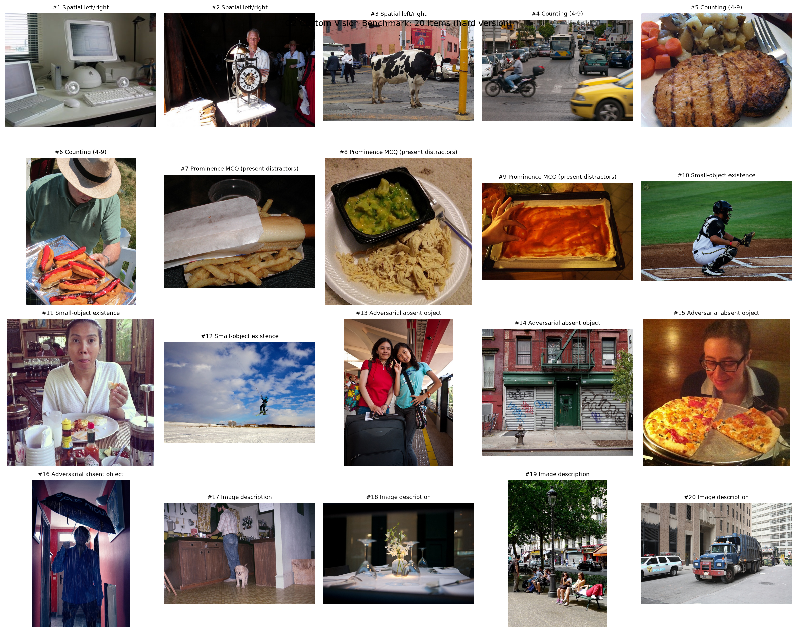

### 4.3 v2 結果（20 題）

| 任務類型 | Qwen2-VL-2B | SmolVLM-2B |
|---|---|---|
| Spatial left/right（3） | **1.00** | 0.33 |
| Counting 4–9（3） | 0.00 | 0.00 |
| Prominence MCQ（3） | 0.33 | **0.67** |
| Small-object existence（3） | 0.67 | 0.67 |
| Adversarial absent（4） | 1.00 | 1.00 |
| **客觀題總計（16）** | **0.625** | 0.562 |
| 計數 MAE | 3.33 | 3.33 |
| 描述題 GT recall / 幻覺率（4 張） | 0.36 / **0.00** | 0.36 / 0.50 |
| Judge 平均（Gemini） | **7.10** | 6.65 |
| 權重 / 平均推理記憶體 | 4.11 GiB / 4.16 GiB | 4.18 GiB / 4.22 GiB |
| 平均延遲 | 0.168 s | **0.125 s** |

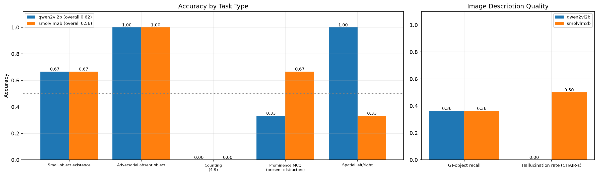
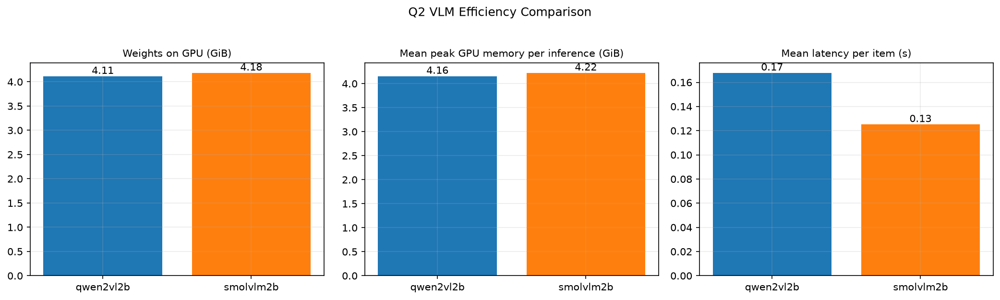
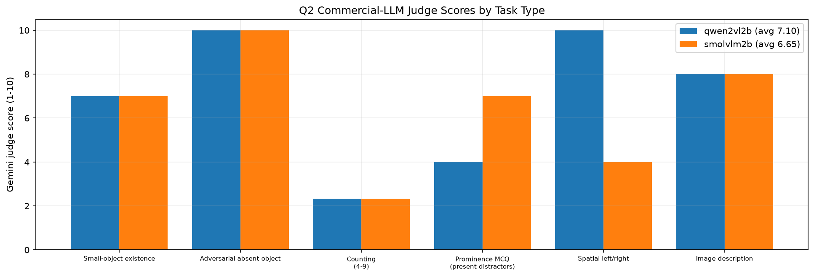
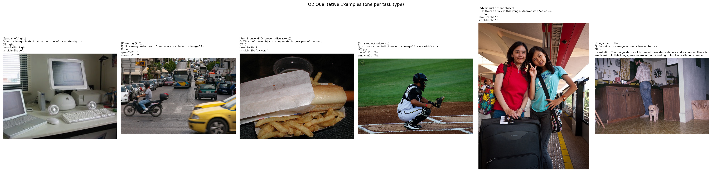

* **v2 成功拉開差距**：客觀題由 v1 的 16/16 vs 16/16 降為 62.5% vs 56.2%，Judge 由 9.85 / 9.80 降為 7.10 / 6.65。
* **空間關係差異最大**：Qwen2-VL 3/3，SmolVLM 1/3（三題都回答 "Left"，偏向固定答案）。
* **計數 4–9 個物件兩者都 0/3 且都低估**：真值 4、6、7，Qwen 答 1、5、1，SmolVLM 答 2、3、2。
* 對抗式負樣本兩者皆 4/4；小物件存在兩者都漏掉同一題（占比 < 2% 的 chair）。
* 描述題：Qwen 0/4 張出現幻覺，SmolVLM 2/4。
* 每類僅 3–4 題（1 題 = 25–33 個百分點），因此只能視為趨勢，以下擴充實驗確認。

### 4.4 擴充實驗（49 題，同出題規則、不同 seed，無 judge）

| 任務類型 | Qwen2-VL-2B | SmolVLM-2B |
|---|---|---|
| Spatial left/right（8） | **1.00** | 0.375 |
| Counting 4–9（8） | **0.25** | 0.00 |
| Prominence MCQ（8） | 0.625 | **0.75** |
| Small-object existence（8） | 0.875 | **1.00** |
| Adversarial absent（12） | **1.00** | 0.75 |
| **客觀題總計（44）** | **0.773** | 0.591 |
| 計數 MAE | **1.50** | 2.38 |
| Yes 比例（真實 0.40） | 0.35 | 0.55 |
| 描述題 recall / 幻覺率（5 張） | 0.48 / **0.20** | 0.53 / 0.40 |
| 延遲 | 0.116 s | **0.070 s** |

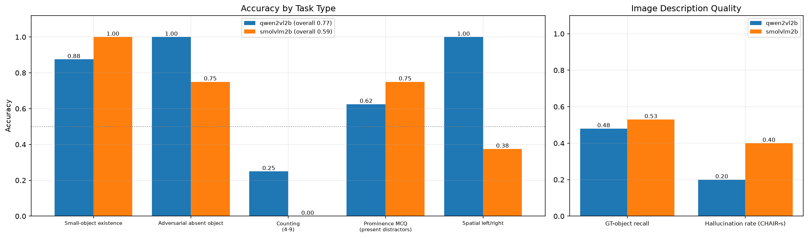

* **趨勢與 20 題一致**：Qwen2-VL 領先（0.773 vs 0.591），主要來自空間關係（8/8 vs 3/8，SmolVLM 低於隨機）與計數（MAE 1.5 vs 2.4）。
* **對抗式負樣本在擴充集才顯出差異**：SmolVLM 12 題錯 3 題（全為偽陽性），Yes 比例 0.55 高於真實的 0.40，傾向附和圖中常見的相關物件；Qwen 12/12。這在 4 題的主 benchmark 看不出來，說明樣本數不足會漏掉效應。
* SmolVLM 在 MCQ 與小物件稍好，但各差 1 題，屬雜訊；SmolVLM 速度約快 1.3–1.7 倍。
* 限制：擴充集與主 benchmark 使用同一影像池（不同 seed），非完全獨立；計數真值來自 COCO 標註，遮擋或群聚時可能含雜訊；CHAIR 依賴同義詞表與標註完整度。

---

## 5. Quiz 3 — DPO 微調與影像畫質實驗

方法：LoRA（r=16）+ DPO（β=0.1，自寫訓練迴圈，reference = 關閉 adapter 的同一模型），以 validation loss 做 **early stopping**（patience=3）並還原最佳 checkpoint。

### 5.1 LLM — 優化面向：簡潔回答

* **RLHF 資料**：Alpaca 指令 142 組訓練 + 20 組驗證；chosen = 同模型在「簡短」system prompt 下的回答，rejected = 預設冗長回答。
* **通用能力 Benchmark**：另取 100 題 MMLU（與優化面向無關）。

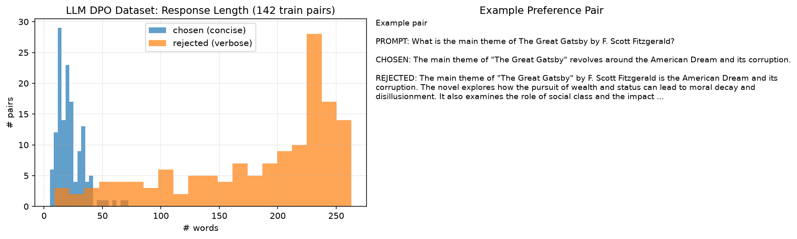
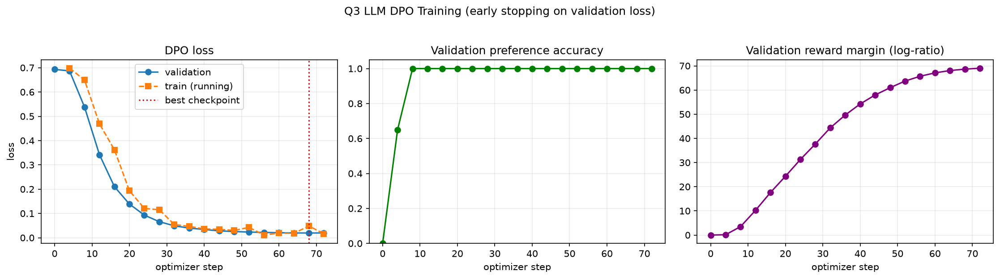

驗證損失 0.687 → 0.020，val accuracy 自 step 8 起為 1.00；全程仍在下降，early stopping 未觸發，訓練至 4 epoch 上限。

| 指標（50 題 held-out） | Base | DPO-tuned |
|---|---|---|
| 平均字數 | 194.2 | **25.2** |
| ≤ 60 字比例 | 0.10 | **0.98** |
| 被截斷比例 | 12% | 0% |
| Judge 有用性 | **8.22** | 6.86 |
| **MMLU-100 accuracy（無關能力）** | 57% | 58% |

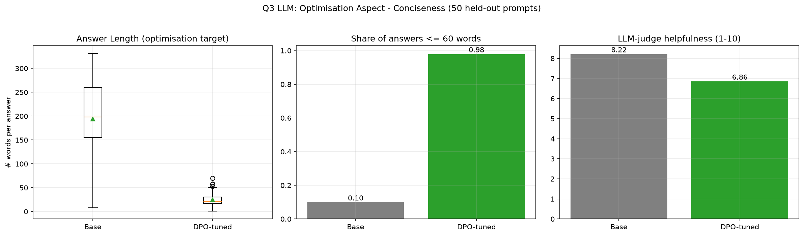
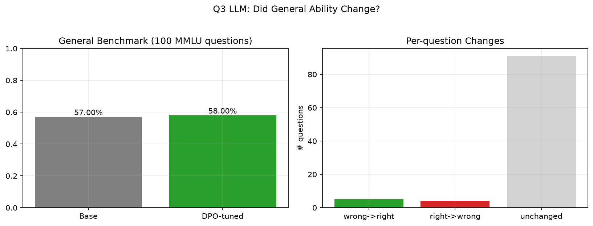

* 優化目標達成（長度約降為 1/8），MMLU 無顯著變化（n=100，±5 個百分點）。
* **代價**：judge 有用性下降 1.36 分，簡短回答資訊量不足；chosen 未經品質過濾，DPO 也過度學到「越短越好」。

### 5.2 VLM — 優化面向：降低物件幻覺

* **偏好資料（COCO 標註）**：每張圖 3 組 — 存在（Yes 為 chosen）、**不存在**（No 為 chosen）、物件列舉（混入不存在物件者為 rejected）；165 組訓練 + 51 組驗證。
* **測試**：114 題存在題（未見過的圖）、30 張描述題。

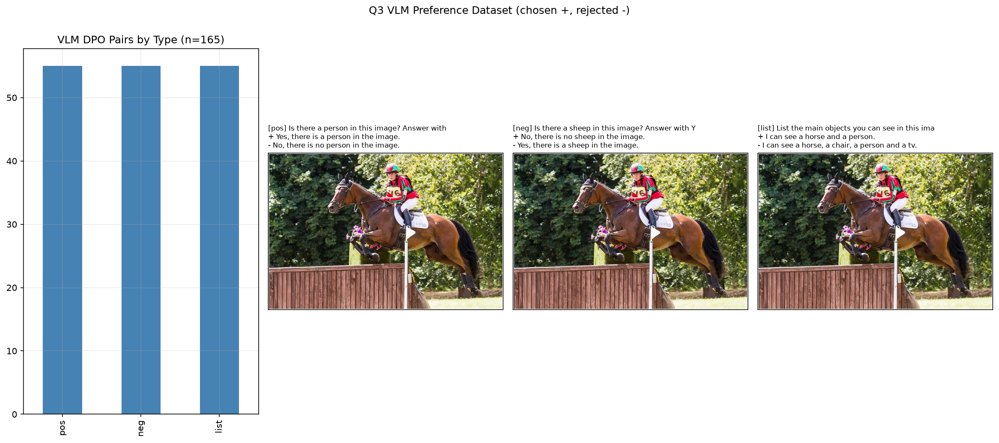
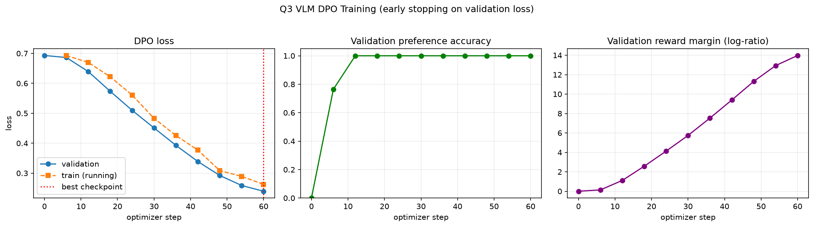

驗證損失 0.686 → 0.240，3 epoch 上限結束時仍在下降，early stopping 未觸發。

| 指標 | Base | DPO-tuned |
|---|---|---|
| 存在題 accuracy / F1 | 1.000 / 1.000 | 1.000 / 1.000 |
| 偽陽性率 | 0.000 | 0.000 |
| 描述題幻覺率（CHAIR-s） | 0.167 | **0.133** |
| 描述題 GT 物件 recall | 0.609 | **0.638** |

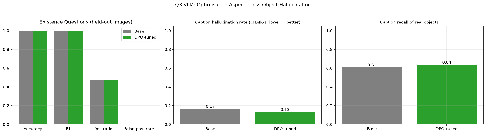

* 存在題 Base 已全對，無提升空間；描述題幻覺率僅由 5/30 降為 4/30 張，**差距過小，無法證明優化有效**。
* 指標限制：COCO 標註不完整，像 `dining table` 會被誤算為幻覺。
* 改進方向：加入對抗式負樣本（與圖中物件常共現的物件）與更多測試圖。

### 5.3 影像畫質實驗（40 題 / 20 張圖，tuned vs base）

6 種擾動 × 5 個強度：亮度、對比、模糊、JPEG 品質、高斯雜訊、解析度。

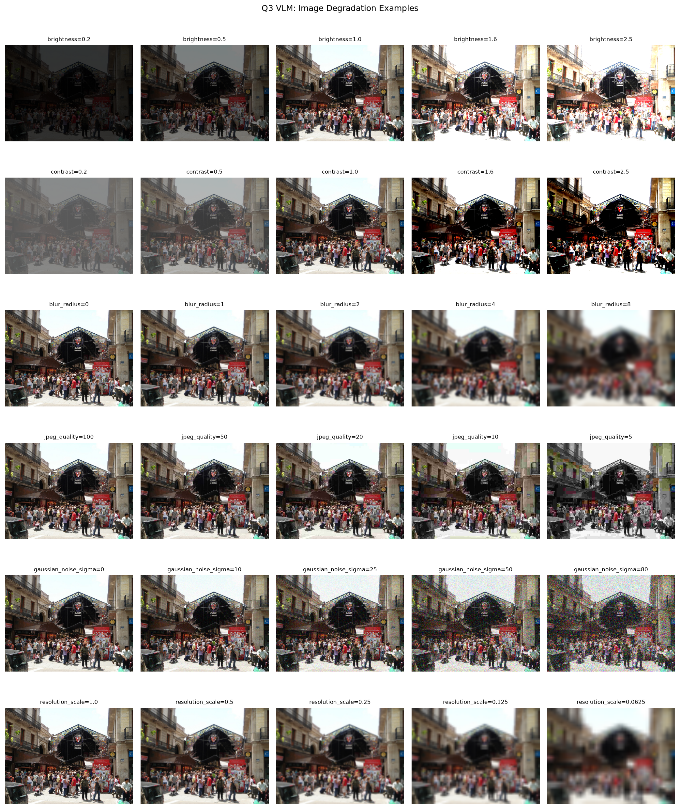
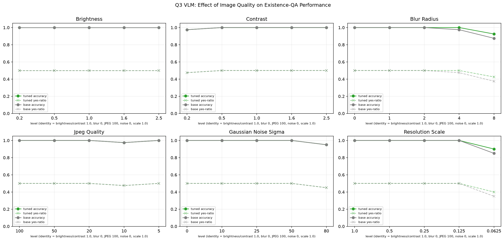

* 對**亮度、對比、JPEG、雜訊相當穩健**；僅**嚴重模糊（半徑 8：0.925 / 0.875）**與**極低解析度（1/16：0.90 / 0.85）**明顯下降。
* 失敗型態是**漏看**（Yes 比例由 0.50 降至 0.375–0.425），而非幻覺（偽陽性未增加）。
* 30 個條件平均 accuracy：tuned ≈ 0.991、base ≈ 0.987，差距不顯著。

---

## 6. 結論與限制

1. Prompt：簡單的 role prompt 最有效；CoT 對格式嚴格的題目有害。
2. 量化：int8 記憶體 −42%、品質接近 bf16 但慢 4.7 倍；int4 −62%、品質略降，**加上 role prompt 後在 2.89 → 1.10 GiB 的同時通過率 0.90 → 1.00**。int4 因 embedding 仍為 bf16 而無法降到 1/4。
3. VLM 比較：v1 皆 100%（天花板），v2 hard benchmark 拉開差距（20 題 0.625 vs 0.562；擴充 44 題 0.773 vs 0.591）。Qwen2-VL-2B 在空間關係、計數、對抗式負樣本與描述幻覺上較好；SmolVLM 較快（約 1.3–1.7 倍），但偏向固定答案（空間題多答 Left）且較容易附和相關物件。兩者對 4–9 個物件的計數都很弱。
4. LLM 微調：成功縮短回答、通用能力不變，但有用性下降，簡潔與完整性需取捨。
5. VLM 微調：存在題已達天花板，未能證明幻覺改善；畫質主要影響嚴重模糊與極低解析度。
6. 共通限制：樣本數小（20 / 40 / 100 題）、單一 seed、judge 為單一商用模型。

## 7. 產出清單

* 圖片：`Outputs/Q1_*.png`、`Outputs/Q2_*.png`、`Outputs/Q3_*.png`
* 模型：`Outputs/q1_qwen2.5-1.5b-instruct_{int8,int4}`、`Outputs/q3_llm_dpo_lora`、`Outputs/q3_vlm_dpo_lora`
* 表格：`Outputs/q1_summary.csv`、`q2_summary.csv`、`q2_summary_extended.csv`、`q3_llm_summary.csv`、`q3_vlm_summary.csv`、`q3_vlm_degradation.csv`
* 資料：`Data/q1_benchmark.json`、`q2_vlm_benchmark_v2.json`、`q2_vlm_benchmark_v2_extended.json`、`coco_val_boxes.json`、`q3_llm_dpo_pairs.json`、`q3_vlm_dpo_pairs.json`、`q3_mmlu100.json`
